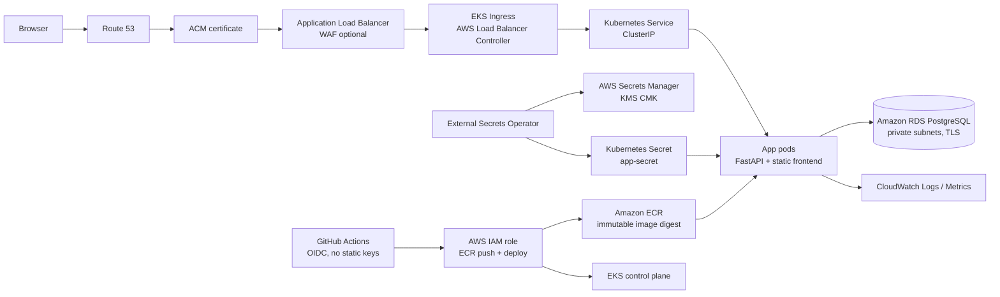

# AWS EKS + IAM — Plan B deployment blueprint

> **Status: plan only, not implemented.** The supported deployment remains
> `docs/DEPLOYMENT.md` (Cloudflare Pages + Render + Neon) and the local
> production-shaped cluster remains `docs/KUBERNETES.md`.
>
> This document is the fallback path if the project must be hosted on AWS EKS
> (Elastic Kubernetes Service). It is deliberately written **before** any AWS
> resource is created, because IAM is the part that is hardest to undo safely.

> **Safety note:** MediCore is a synthetic-data demo. It is **not** a medical
> device, is **not** clinically validated, and must **not** hold real patient
> data. AWS hosting does not change that. IAM is necessary but not sufficient:
> real patient data still requires legal, privacy, security, clinical, and
> regulatory review, plus BAAs with every vendor.

---

## 1. When Plan B makes sense

Choose AWS EKS only if at least one of these is true:

- the organisation already standardises on AWS and IAM;
- the project must run inside an existing VPC, private subnets, or AWS
  networking/security baseline;
- a customer or contract requires AWS-region residency or AWS-native audit
  controls;
- the team already operates EKS and has Terraform/platform ownership.

For the **$100–$200 AWS Free Tier demo**, do not start with EKS. Use
`docs/AWS_FREE_TIER_DEMO_PLAN.md`: one EC2 + Docker Compose, with optional k3s
on the same instance for the Kubernetes bonus. EKS’s control plane alone is
roughly $73/month before nodes or storage.

Do **not** choose EKS for a free demo. Even a minimal cluster has a fixed
control-plane cost and several moving parts (ALB, NAT, RDS, Secrets Manager,
CloudWatch). The current Render/Neon/Cloudflare path is much cheaper and
simpler for synthetic demo data.

| Question | If yes |
|---|---|
| Is AWS mandated? | EKS is a reasonable Plan B. |
| Is a free/low-cost demo the goal? | Stay on `docs/DEPLOYMENT.md`. |
| Do you need private VPC networking and AWS-native IAM? | EKS fits. |
| Do you need a single-origin browser app? | Keep FastAPI serving the frontend on EKS (recommended). |
| Do you need the frontend on S3/CloudFront? | Read §2.2 first — cross-site cookies need a same-origin proxy or a redesign. |

---

## 2. Target architecture

### 2.1 Recommended: single-origin app on EKS

This preserves the current architecture: FastAPI serves both `/api/v1` and the
static frontend, so session cookies stay first-party.



Key decisions:

- **RDS, not PostgreSQL in a pod.** The local `k8s/postgres.yaml` is for the
  demo cluster only. Production-shaped AWS uses RDS with automated backups,
  private subnets, TLS, and least-privilege database roles.
- **External Secrets Operator, not secrets in Git.** Secrets Manager is the
  source of truth; ESO syncs a Kubernetes Secret; the app reads environment
  variables exactly as it does today.
- **App pods need no AWS identity at runtime.** If ESO syncs the secret and a
  DaemonSet ships logs, the app itself can run with **zero AWS IAM
  permissions**. That is the smallest blast radius and the preferred design.
- **ALB Ingress, not a public Service.** Use the AWS Load Balancer Controller
  with ACM TLS and Route 53 DNS. A `LoadBalancer` Service would create a
  classic/network LB without the same ingress controls.

### 2.2 Alternative: S3 + CloudFront frontend, EKS backend

This splits the frontend from the API. It is **not** a drop-in change:

- the browser origin becomes CloudFront, while the API is on the ALB;
- `cap_session` is `SameSite=Lax`, so a cross-site API call will not carry the
  session cookie;
- `connect-src 'self'` and the CSRF double-submit assumptions change;
- you would need a same-origin `/api/*` proxy at the edge, or a deliberate
  cross-site cookie/CORS redesign with a security review.

For Plan B, keep the single-origin app on EKS unless there is a strong reason
to split it.

---

## 3. IAM model at a glance

Use **EKS Pod Identity** for new clusters; use **IRSA** only if an existing
cluster or tool requires it. Do not mix both for the same workload.

| Principal | Trusted by | Permissions | Scope | Notes |
|---|---|---|---|---|
| **Human SSO roles** | IAM Identity Center | Permission sets: viewer / developer / admin | AWS account + EKS access entries | No IAM users, no long-lived keys, MFA required |
| **EKS cluster role** | `eks.amazonaws.com` | `AmazonEKSClusterPolicy` (managed) | Cluster | Assumed by the EKS control plane, not by pods |
| **Node role** | `ec2.amazonaws.com` | `AmazonEKSWorkerNodePolicy`, `AmazonEKS_CNI_Policy`, `AmazonEC2ContainerRegistryReadOnly` | Managed node group / Karpenter nodes | Kubelet needs ECR pull; do **not** give it app secrets |
| **App pod role** | EKS Pod Identity / IRSA | Prefer **none** | — | With ESO, the app only reads a Kubernetes Secret |
| **External Secrets role** | EKS Pod Identity / IRSA | `secretsmanager:GetSecretValue`, `DescribeSecret`; `kms:Decrypt` on the CMK | Specific secret ARNs + key ARN | Scoped to the `external-secrets` service account/namespace |
| **ALB controller role** | EKS Pod Identity / IRSA | Official AWS Load Balancer Controller IAM policy (customer-managed) | Cluster | Use the official policy JSON, not a hand-rolled wildcard |
| **EBS CSI role** | EKS Pod Identity / IRSA | `AmazonEBSCSIDriverPolicy` | Cluster | Only if you use EBS PVCs; RDS is preferred for the database |
| **Karpenter / autoscaler** | EKS Pod Identity / IRSA | Controller policy + node role | Cluster | Optional; only if you need autoscaling |
| **ExternalDNS** | EKS Pod Identity / IRSA | `route53:ChangeResourceRecordSets` | Specific hosted zone | Optional |
| **CI/CD role** | GitHub OIDC federation | ECR push, `eks:DescribeCluster`, Kubernetes deploy RBAC | Specific repo/branch/environment + namespace | No AWS access keys in GitHub |
| **Break-glass role** | Human SSO + MFA | Time-bounded admin | Account + cluster | Documented, alarmed, tested; not for routine use |

### 3.1 Trust policy rules

- One role per workload. Never reuse the node role for application secrets.
- Trust only the exact OIDC provider / Pod Identity association, namespace,
  and service account.
- For IRSA, the `sub` condition must be exact, for example
  `system:serviceaccount:clinical:external-secrets`, not `*`.
- For GitHub OIDC, scope `sub` to the repository and protected environment:
  `repo:<ORG>/<REPO>:environment:production` or
  `repo:<ORG>/<REPO>:ref:refs/heads/main`.
- For service roles that can be confused-deputy targets, add
  `aws:SourceAccount` and `aws:SourceArn` conditions where AWS supports them.
- No `Principal: "*"` without a condition that proves the caller.
- No `Action: "*"` and no `Resource: "*"` in application roles.

### 3.2 Illustrative GitHub OIDC trust policy

```json
{
  "Version": "2012-10-17",
  "Statement": [
    {
      "Effect": "Allow",
      "Principal": {
        "Federated": "arn:aws:iam::<ACCOUNT_ID>:oidc-provider/token.actions.githubusercontent.com"
      },
      "Action": "sts:AssumeRoleWithWebIdentity",
      "Condition": {
        "StringEquals": {
          "token.actions.githubusercontent.com:aud": "sts.amazonaws.com"
        },
        "StringLike": {
          "token.actions.githubusercontent.com:sub": "repo:<ORG>/<REPO>:environment:production"
        }
      }
    }
  ]
}
```

This is illustrative. Verify the current GitHub OIDC claim names and your
repository/environment names before applying it.

---

## 4. Least-privilege policy shapes

### 4.1 External Secrets Operator

```json
{
  "Version": "2012-10-17",
  "Statement": [
    {
      "Effect": "Allow",
      "Action": [
        "secretsmanager:GetSecretValue",
        "secretsmanager:DescribeSecret"
      ],
      "Resource": [
        "arn:aws:secretsmanager:<REGION>:<ACCOUNT_ID>:secret:medicore/prod/app-*"
      ]
    },
    {
      "Effect": "Allow",
      "Action": "kms:Decrypt",
      "Resource": "arn:aws:kms:<REGION>:<ACCOUNT_ID>:key/<KEY_ID>"
    }
  ]
}
```

- Scope to the exact secret path/ARNs, not `secret:*`.
- If Secrets Manager uses the AWS-managed key, the KMS statement may not be
  needed; with a customer-managed key it is required.
- Do not grant `secretsmanager:ListSecrets` or `PutSecretValue` to the syncer
  unless a specific rotation workflow needs it.

### 4.2 CI/CD role

Grant only what the pipeline does:

- `ecr:GetAuthorizationToken` (account-wide by AWS design);
- `ecr:BatchCheckLayerAvailability`, `InitiateLayerUpload`,
  `UploadLayerPart`, `CompleteLayerUpload`, `PutImage` on the specific repo;
- `eks:DescribeCluster` on the specific cluster;
- Kubernetes RBAC/access entry for a namespace-scoped deploy role.

Do **not** give CI `cluster-admin`, `iam:*`, or `secretsmanager:*`. A
compromised pipeline should not be able to read production secrets or change
IAM.

### 4.3 Human access

- Use IAM Identity Center permission sets, not shared IAM users.
- Map AWS roles to EKS access entries (the modern replacement for editing
  `aws-auth` manually).
- Separate read-only, developer, and admin groups.
- Require MFA; alarm on root use; disable root access keys.
- Break-glass is a separate, time-bounded role with an alarm and a documented
  procedure.

---

## 5. Secrets and configuration

| Item | Where it lives | Notes |
|---|---|---|
| `APP_SECRET_KEY` | Secrets Manager | Generated fresh for AWS; never reuse local values |
| `DATABASE_URL` | Secrets Manager | RDS endpoint, TLS required, app role only |
| `MIGRATION_DATABASE_URL` | Secrets Manager | Separate migrator role; used by the migration Job |
| `LLM_API_KEY` | Secrets Manager | Optional; server-side only |
| `WHISPER_BEARER_TOKEN` | Secrets Manager | Optional private speech service |
| `DEMO_*` passwords | **Do not use in production** | Demo seed only; never create shared demo accounts in a real deployment |
| Non-secret settings | Kubernetes ConfigMap | Origins, cookie names, model names, timeouts |

Rules:

- Never put secrets in `k8s/configmap.yaml`, the image, Git, CI logs, or a
  Helm values file committed to the repository.
- Use a customer-managed KMS key for Secrets Manager and RDS where required;
  grant `kms:Decrypt` only to the roles that need it.
- Prefer ESO sync into a Kubernetes Secret. The app keeps using `envFrom`, so
  no application code changes are needed.
- RDS credentials should be rotated through Secrets Manager. Remember that a
  rotated secret does not automatically change a live database password; use a
  rotation Lambda/runbook that updates both.
- Separate the **app** database role (DML on the app schemas) from the
  **migrator** role (DDL). Never run the app as the RDS master user.
- Do not run the demo seed Job in production. Bootstrap accounts through an
  approved administrative process.

---

## 6. Network and cluster security baseline

- **VPC:** private subnets for EKS nodes and RDS; public subnets only for the
  ALB and NAT gateways (or VPC endpoints). Use at least two AZs.
- **RDS:** no public accessibility; security group accepts 5432 only from the
  EKS node/pod security group; TLS required (`sslmode=require`); automated
  backups and deletion protection on.
- **EKS API endpoint:** private access enabled; public access restricted to
  approved CIDRs or disabled with SSM/bastion access. Do not expose
  `0.0.0.0/0`.
- **Ingress:** ALB + ACM certificate + Route 53; WAF optional but recommended;
  redirect HTTP to HTTPS; keep the app's existing security headers.
- **Pods:** Pod Security Standards `restricted`; non-root; read-only root
  filesystem; drop all capabilities; seccomp `RuntimeDefault`; resource
  requests/limits; network policies; PodDisruptionBudget; at least two app
  replicas.
- **Images:** ECR scan-on-push, immutable tags/digests, lifecycle policy, KMS
  encryption; deploy by digest, not `latest`.
- **Audit:** CloudTrail organisation trail, EKS control-plane logs to
  CloudWatch, GuardDuty, Security Hub, AWS Config, VPC Flow Logs, and alarms
  for root use, IAM changes, public bucket/RDS changes, and failed
  authentication spikes.

---

## 7. Deployment sequence

This is the order that keeps IAM and secrets from becoming an afterthought.

1. **Account baseline**
   - AWS Organizations, separate dev/staging/prod accounts where possible.
   - Root MFA, no root use, SCP guardrails, CloudTrail organisation trail.
   - IAM Identity Center, permission sets, break-glass procedure.
2. **Terraform state and KMS**
   - S3 state bucket with versioning/encryption, DynamoDB lock table, KMS key.
   - CI OIDC provider and a narrowly scoped plan/apply role.
3. **Network**
   - VPC, private/public subnets, NAT or VPC endpoints, route tables, security
     groups. No public RDS.
4. **Data**
   - RDS PostgreSQL, parameter group, automated backups, KMS, Secrets Manager
     secret, app and migrator roles.
5. **Registry**
   - ECR repository, scan-on-push, immutable tags, lifecycle policy.
6. **Cluster**
   - EKS cluster with a dedicated cluster role and node role; managed node
     group or Karpenter; OIDC/Pod Identity agent; VPC CNI, CoreDNS,
     kube-proxy; EBS CSI only if needed.
7. **Cluster add-ons**
   - AWS Load Balancer Controller, External Secrets Operator, metrics-server;
     Karpenter/Cluster Autoscaler and ExternalDNS only if needed.
8. **Workload IAM**
   - Service accounts + Pod Identity associations/IRSA roles for ESO, ALB
     controller, and optional autoscaler/DNS. The app service account should
     normally have **no AWS role**.
9. **Secrets**
   - Put secrets in Secrets Manager; create the ExternalSecret; verify the
     Kubernetes Secret exists and contains the expected keys (names only).
10. **Image**
    - Build in CI, push to ECR by digest, scan, sign/provenance if available.
11. **Database migration**
    - Run a one-shot migration Job with `MIGRATION_DATABASE_URL` and
      `RUN_MIGRATIONS_ON_START=0`; never let every app replica run migrations.
12. **Application**
    - Deploy at least two replicas, probes, resources, PDB, topology spread,
      `APP_ENV=production`, real origins, `RUN_MIGRATIONS_ON_START=0`.
13. **Ingress and DNS**
    - ALB Ingress, ACM certificate, Route 53 record, HTTPS redirect, WAF.
14. **Verification**
    - `/health/live`, `/health/ready`, login, patient list, appointment create,
      audit/log stream, print/PDF, optional AI/voice. Use synthetic data only.
15. **Operations**
    - RDS backup/restore drill, CloudWatch alarms, budget alarms, cost review,
      access review, incident runbook, teardown checklist.

---

## 8. Mapping from the local Kubernetes manifests

| Local (`k8s/`) | AWS Plan B |
|---|---|
| `postgres.yaml` (StatefulSet + PVC) | RDS PostgreSQL in private subnets; no in-cluster database |
| `secret.yaml` (gitignored local file) | Secrets Manager + External Secrets Operator → Kubernetes Secret |
| `app-service.yaml` (`LoadBalancer`) | `ClusterIP` Service + ALB Ingress |
| `ingress.example.yaml` (ingress-nginx) | ALB Ingress with ACM certificate and Route 53 |
| `app-deployment.yaml` (`medicalplatform-app:local`) | ECR image by digest; 2+ replicas; Pod Identity service account; production probes/resources/PDB |
| `configmap.yaml` (localhost origins, `APP_ENV=development`) | Production ConfigMap: real origins, `APP_ENV=production`, `RUN_MIGRATIONS_ON_START=0` |
| `seed-job.yaml` | Demo only — **never** in production |
| `scripts/k8s/*` | CI/CD pipeline + Terraform/eksctl; no manual click-ops |

Additional changes required before EKS:

- Remove the `wait-for-db` init container's in-cluster `db.clinical.svc`
  dependency; point it at the RDS endpoint or rely on the migration Job.
- Add a `ServiceAccount` for the app (even with no AWS role, it is useful for
  identity and network policy).
- Move migrations to a separate Job.
- Add HPA/PDB/topology spread and network policies.
- Set `APP_ENV=production`, real `PUBLIC_ORIGIN`, `API_BASE_URL`, and
  `ALLOWED_ORIGINS`.
- Keep the app's existing non-root/read-only-root security context.

---

## 9. IAM checklist before the first deploy

- [ ] Root account has MFA; root access keys do not exist; root is not used.
- [ ] AWS Organizations/SCPs and a CloudTrail organisation trail exist.
- [ ] Humans use IAM Identity Center/SSO; no shared IAM users or access keys.
- [ ] MFA is enforced for human access; break-glass is documented and alarmed.
- [ ] Cluster, node, app, ESO, ALB, and CI roles are separate.
- [ ] EKS Pod Identity/IRSA trust is scoped to the exact namespace and service
      account.
- [ ] No application role has `Action: "*"` or `Resource: "*"`.
- [ ] Secrets access is scoped to exact secret ARNs; KMS decrypt is scoped to
      the CMK.
- [ ] GitHub OIDC trust is scoped to the repository and protected
      environment/branch; no static AWS keys in CI.
- [ ] CI cannot read production secrets or change IAM.
- [ ] RDS is not publicly accessible; TLS is required; app and migrator roles
      are separate.
- [ ] ECR scan-on-push and immutable tags/digests are enabled.
- [ ] EKS public endpoint is restricted; control-plane logs are enabled.
- [ ] CloudWatch alarms, GuardDuty, Security Hub, Config, and VPC Flow Logs are
      enabled.
- [ ] Budget alarms and a teardown checklist exist.
- [ ] RDS backup/restore has been tested, not just enabled.
- [ ] Access review and offboarding procedure exist.

---

## 10. Common IAM mistakes to avoid

| Mistake | Why it hurts | Better |
|---|---|---|
| Using the node role to read app secrets | Every pod on the node can inherit the permission | ESO with a dedicated role; app pod has no AWS role |
| `Principal: "*"` in a trust policy | Any AWS principal may assume the role | Exact OIDC/Pod Identity subject + conditions |
| `Action: "*"`, `Resource: "*"` | One compromised pod/CI job owns the account | Explicit actions and ARNs |
| Missing `aws:SourceAccount` / `aws:SourceArn` | Confused-deputy risk | Add conditions where AWS supports them |
| Forgetting `kms:Decrypt` | ESO cannot read a CMK-encrypted secret | Grant decrypt on the specific key |
| IRSA `sub` wildcard | Any service account can assume the role | Exact `system:serviceaccount:<ns>:<sa>` |
| GitHub OIDC `repo:org/*` | Any repo/branch can deploy | Exact repo + environment/branch |
| Long-lived AWS access keys in CI or pods | Keys leak and never expire | OIDC / Pod Identity / IRSA |
| Secrets in ConfigMaps, images, or logs | Permanent exposure in Git, registries, or logs | Secrets Manager + ESO; never log values |
| Public RDS or `0.0.0.0/0` on 5432 | Database exposed to the internet | Private subnets + security groups |
| Editing `aws-auth` by hand | Drift and hard-to-audit access | EKS access entries |
| `cluster-admin` for CI | A pipeline compromise becomes cluster compromise | Namespace-scoped deploy role |
| No cost alarms | EKS/NAT/ALB/RDS bills surprise | AWS Budgets + alerts + teardown |

---

## 11. Cost guardrails (rough order of magnitude)

Plan B is **not free**. Budget for:

- EKS control plane (per cluster/hour);
- EC2 nodes or Karpenter-provisioned instances;
- NAT gateway(s) and data transfer;
- Application Load Balancer;
- RDS instance, storage, backups;
- Secrets Manager secrets and API calls;
- CloudWatch logs/metrics, GuardDuty, Config, Security Hub;
- ECR storage and scanning;
- Route 53 hosted zone and ACM (ACM public certificates are free, but the
  load balancer is not).

Set AWS Budgets alarms before deploying. Add a teardown checklist: delete the
Ingress/Service, EKS node groups/cluster, RDS (with final snapshot if needed),
NAT gateways, ALB, ECR images, Secrets Manager secrets, CloudWatch log groups,
and the VPC. KMS keys with deleted material cannot be recovered immediately;
plan key deletion carefully.

---

## 12. Explicit non-claims

- This is a **plan**, not an implemented or verified AWS deployment.
- IAM is necessary but not sufficient for security or compliance.
- No HIPAA, GDPR, ISO 27001, SOC 2, or clinical-validation claim is made.
- Real patient data is prohibited in this demo regardless of hosting provider.
- AWS shared responsibility means the team still owns patching, IAM review,
  monitoring, backups, incident response, and cost control.
- Managed services reduce some operational work; they do not transfer legal or
  clinical responsibility.

---

## 13. References

- `docs/KUBERNETES.md` — local production-shaped cluster and manifest mapping.
- `docs/DEPLOYMENT.md` — current supported deployment.
- `docs/SECURITY.md` — application permissions, sessions, audit, secrets.
- `docs/BACKLOG.md` — deferred production work (B39 tracks this plan).
- AWS documentation: EKS Pod Identity, IRSA, IAM best practices, Secrets
  Manager, AWS Load Balancer Controller, RDS security, CloudTrail, GuardDuty.
