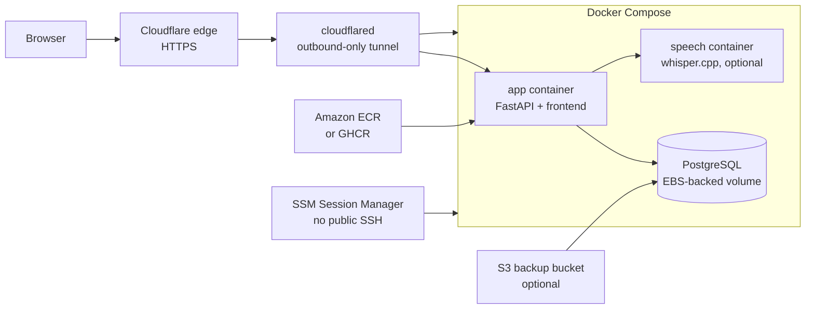

# AWS Free-Tier Demo — One EC2, Docker Compose, and optional k3s

> **Status: plan only, not implemented.** Synthetic demo data only. Not a
> medical device, not clinically validated, and not approved for real patient
> data. See `docs/AWS_EKS_IAM_PLAN.md` for the full EKS/IAM fallback.

## 1. Short answer

For a **$100–$200 AWS Free Tier demo**, the best fit is:

```text
One EC2 instance
  └── Docker Compose
       ├── cloudflared (Cloudflare Tunnel, HTTPS)
       ├── app (FastAPI + static frontend)
       ├── PostgreSQL
       └── speech (whisper.cpp, optional)
```

Then, as the **Kubernetes bonus**, install **k3s** on the same EC2 and deploy
the same Docker images as Kubernetes Deployments/StatefulSet/Services/Ingress.

Do **not** start with EKS. The EKS control plane alone is roughly **$0.10/hour
(~$73/month)** before nodes, storage, NAT, or load balancers. That consumes most
of the credit before the demo is useful. EKS is a Plan B for a paid account or a
short, deliberate EKS demonstration.

## 2. What the Free Tier actually gives you

AWS’s current new-customer offer (for accounts created on/after 2025-07-15):

- **$100 in credits at sign-up**.
- **Up to $100 more** by completing five activities in the Explore AWS widget
  (EC2, RDS, Lambda, Bedrock, AWS Budgets; **$20 each**).
- **6 months** or until credits are exhausted, whichever comes first.
- The Free plan has **no charges** but is limited to selected services; the
  account closes after 6 months/credits, and AWS retains data for 90 days.
- Always-free monthly limits still apply to some services.

Check the current offer before starting:

- <https://aws.amazon.com/free/>
- <https://docs.aws.amazon.com/awsaccountbilling/latest/aboutv2/free-tier-plans.html>
- <https://docs.aws.amazon.com/awsaccountbilling/latest/aboutv2/free-tier-plans-activities.html>

**Important:** the Free plan is limited to a subset of AWS services. EKS may not
be available on the Free plan; verify in the console before designing around it.
If EKS is unavailable, use k3s on EC2 or upgrade to the Paid plan.

## 3. Option comparison

| Option | Monthly-ish cost | Kubernetes? | Best for |
|---|---:|---|---|
| **Docker Compose on one EC2** | ~$15–$25 | No | Cheapest, simplest demo |
| **k3s on the same EC2** | ~$15–$25 | Yes (lightweight) | Kubernetes bonus without EKS cost |
| **EKS + one small node** | ~$85–$95 | Yes (managed) | Only if EKS itself is required |
| **EKS + NAT + ALB** | ~$130+ | Yes | Not appropriate for this budget |

Approximate costs to verify against current pricing:

- `t4g.small` (2 vCPU burstable, 2 GB) ~$12–$15/month.
- `t3.small` (2 vCPU burstable, 2 GB) ~$15–$18/month.
- `m7i-flex.large` (2 vCPU, 8 GB) ~$65–$75/month — comfortable for whisper.cpp,
  but consumes credits much faster.
- 30 GB gp3 EBS ~$2.40/month.
- Public IPv4 ~$3.65/month (check current AWS pricing).
- ECR storage a few cents/GB-month; CloudWatch small.
- EKS control plane ~$73/month; one node ~$12–$18; EBS ~$2.40.
- NAT gateway ~$33/month + data; ALB ~$16/month + LCU. Avoid both for the demo.

With $200 credits and a `t4g.small`, the infrastructure cost is roughly
**$15–$25/month**, so the 6-month Free plan window is the limiting factor, not
the credit balance. With EKS, the control plane alone consumes the credit in
roughly 1.5–2.5 months.

## 4. Recommended architecture



### Why one EC2 is enough

- The app is a **single-origin FastAPI image** serving both `/api/v1` and the
  static frontend.
- PostgreSQL is synthetic and small; a Docker volume on EBS is sufficient for a
  demo. RDS adds cost and networking without improving the demo story.
- whisper.cpp Base is CPU-only and optional. Run it only when demonstrating
  voice; otherwise keep `WHISPER_BASE_URL` empty and use manual scheduling.
- **Cloudflare Tunnel** provides public HTTPS through an outbound-only
  connection, so the EC2 needs **no inbound 80/443 ports**, no public load
  balancer, and no ACM/Route 53 setup. Caddy is an optional alternative if you
  prefer a direct domain-to-EC2 setup.

### Sizing guidance

| Instance | RAM | Fit |
|---|---:|---|
| `t4g.micro` / `t3.micro` | 1 GB | App + Postgres only; no whisper; likely too tight |
| `t4g.small` / `t3.small` | 2 GB | App + Postgres + cloudflared; whisper only with swap and patience |
| `m7i-flex.large` | 8 GB | Comfortable app + Postgres + whisper; costs credits faster |

Start with `t4g.small` (ARM) if the image supports it; the app image is
multi-arch? Verify before choosing. If not, use `t3.small`. Add 2 GB swap for
whisper.cpp on a 2 GB instance.

## 5. Runbook — Docker Compose on one EC2

### 5.1 Account and guardrails

1. Create the AWS account and choose the **Free plan**.
2. Set a **$10 / $50 / $100 AWS Budget** with email alerts. This is also one of
   the $20 credit activities.
3. Pick one region and stay there.
4. Enable MFA on the root account; do not create root access keys.
5. Create an EC2 instance role (no static keys) with:
   - `AmazonSSMManagedInstanceCore` (Session Manager);
   - `AmazonEC2ContainerRegistryReadOnly` if pulling from ECR;
   - optional S3 backup policy scoped to one bucket/prefix;
   - optional CloudWatch agent policy.
6. Security group:
   - **no inbound 80/443** — Cloudflare Tunnel is outbound-only;
   - `22` only from your IP, or **no SSH** and use SSM Session Manager;
   - **never** expose `5432` or `8080` publicly;
   - outbound `443` must be allowed for Cloudflare, ECR, and the optional LLM.

### 5.2 Launch

1. Launch a Free-plan-eligible instance (`t4g.small` or `t3.small`).
2. Attach the instance role and a 30 GB gp3 volume.
3. Add cloud-init/user-data to install Docker, the Compose plugin, and Git.
4. Connect with **SSM Session Manager**, not a public SSH key.
5. Clone the repository or pull the images from ECR/GHCR.
6. Start the stack with the Cloudflare Tunnel overlay (see §5.5).

### 5.3 Configure

Create `/opt/medicore/.env` with mode `600` (or load the same values from SSM
Parameter Store):

```dotenv
APP_ENV=production
PUBLIC_ORIGIN=https://demo.example.com
API_BASE_URL=https://demo.example.com
ALLOWED_ORIGINS=https://demo.example.com
APP_SECRET_KEY=<generated>
DATABASE_URL=postgresql+asyncpg://app:<password>@db:5432/clinical_demo
MIGRATION_DATABASE_URL=postgresql+asyncpg://app:<password>@db:5432/clinical_demo
POSTGRES_USER=app
POSTGRES_PASSWORD=<generated>
POSTGRES_DB=clinical_demo
SESSION_COOKIE_NAME=cap_session
CSRF_COOKIE_NAME=csrf_token
CLINIC_TIMEZONE=Europe/Sofia
LLM_API_BASE_URL=https://opencode.ai/inference/go
LLM_MODEL=deepseek-v4.1-flash
LLM_CORRECTION_MODEL=gpt-6-luna
LLM_API_KEY=<optional>
WHISPER_BASE_URL=http://speech:8080
WHISPER_AUTH_MODE=none
DEMO_ADMIN_EMAIL=admin@example.com
DEMO_ADMIN_PASSWORD=<generated>
DEMO_DOCTOR_EMAIL=doctor@example.com
DEMO_DOCTOR_PASSWORD=<generated>
DEMO_NURSE_EMAIL=nurse@example.com
DEMO_NURSE_PASSWORD=<generated>
```

- `APP_ENV=production` only behind real HTTPS. On plain HTTP, use
  `APP_ENV=development` for the demo and accept the security caveat.
- Do not reuse local demo passwords. Generate fresh values.
- `LLM_API_KEY` is optional; the app works without AI. If used, set a budget cap
  in the OpenCode Console.
- `WHISPER_BASE_URL` can be empty to disable voice; manual scheduling still works.

### 5.4 Start and verify

```bash
cd /opt/medicore
docker compose build app
docker compose up -d db app
docker compose run --rm app python /app/scripts/seed_demo_data.py
curl -fsS http://127.0.0.1:8000/health/live
curl -fsS http://127.0.0.1:8000/health/ready
```

If the image is pulled from ECR/GHCR instead of built locally, use
`docker compose pull app` before `up`.

Then start the Cloudflare Tunnel and verify:

- `https://demo.example.com/health/ready` → `200`
- login with a demo Doctor account
- patient list, patient detail, appointments, print/PDF
- optional AI and voice flows
- logs show no secrets

### 5.5 Cloudflare Tunnel (primary path)

Cloudflare Tunnel gives the demo a public HTTPS hostname without opening inbound
ports, running an ALB, or managing certificates on the instance.

#### Create the tunnel

1. Open **Cloudflare Zero Trust → Networks → Tunnels → Create a tunnel**.
2. Choose **Cloudflared**, name it `medicore-demo`, and save.
3. Choose **Docker** as the connector. Copy the tunnel token.
4. Add a **Public Hostname**:
   - Subdomain/domain: `demo.example.com`
   - Service: `http://app:8000`
5. Save. Cloudflare creates the proxied DNS record automatically.

The token is a credential. Store it only in the instance's gitignored `.env` or
in SSM Parameter Store; never commit it, print it, or put it in an image.

#### Add the token and start the overlay

In `/opt/medicore/.env` (mode `600`):

```dotenv
CLOUDFLARE_TUNNEL_TOKEN=<token from the dashboard>
```

Start the stack with the optional tunnel overlay:

```bash
cd /opt/medicore
docker compose -f docker-compose.yml -f docker-compose.tunnel.yml up -d
```

The overlay is `docker-compose.tunnel.yml`; it runs `cloudflared` with the
`TUNNEL_TOKEN` environment variable and depends on the app health check. No
inbound 80/443 ports are required.

For extra safety, bind the app port to localhost only:

```dotenv
APP_PORT=127.0.0.1:8000
```

Then the EC2 security group needs only SSM/SSH; outbound `443` is enough for the
tunnel.

#### Set the app's public origin

```dotenv
APP_ENV=production
PUBLIC_ORIGIN=https://demo.example.com
API_BASE_URL=https://demo.example.com
ALLOWED_ORIGINS=https://demo.example.com
```

Restart the app after changing these values:

```bash
docker compose -f docker-compose.yml -f docker-compose.tunnel.yml up -d app
```

#### Verify

```bash
curl -fsS https://demo.example.com/health/live
curl -fsS https://demo.example.com/health/ready
docker compose -f docker-compose.yml -f docker-compose.tunnel.yml logs --tail=50 cloudflared
```

A healthy connector logs a registered tunnel connection. Then test login,
patient search, patient detail, appointments, and print/PDF through the public
hostname.

Cloudflare notes:

- Keep the DNS record **proxied** (orange cloud); Cloudflare terminates HTTPS at
  the edge.
- Optionally add a **Cloudflare Access** policy (email OTP) in front of the
  hostname for an extra layer; the app still has its own login.
- Cloudflare may cache static assets. After a redeploy, purge the cache or add a
  cache rule that bypasses `/api/*` and HTML. The app already sends
  `Cache-Control: no-cache` for JS/CSS.
- Verify the System Logs live stream (SSE) through the tunnel. If a proxy buffers
  it, add a bypass rule for `/api/v1/admin/logs/stream`.
- If the tunnel token is exposed, rotate it in the Cloudflare dashboard and
  update `.env`; anyone with the token can attach a connector to the tunnel.

#### Quick tunnel (throwaway demo only)

For a short test without a domain:

```bash
cloudflared tunnel --url http://localhost:8000
```

It prints a random `https://<name>.trycloudflare.com` URL. The URL changes when
the process restarts and is not suitable for a stable demo. Set
`APP_ENV=development` and add the generated URL to `ALLOWED_ORIGINS` for the
duration of the test.

#### Caddy fallback

If you prefer a direct domain-to-EC2 setup instead of Cloudflare Tunnel, Caddy
is a valid alternative:

```caddyfile
demo.example.com {
    reverse_proxy app:8000
}
```

Caddy obtains and renews the certificate automatically; open `80` and `443` for
HTTP-01/TLS-ALPN. This is optional and not needed with Cloudflare Tunnel.

### 5.6 Speech (optional)

```bash
docker compose --profile speech up -d speech
```

On a 2 GB instance:

- add 2 GB swap;
- run whisper.cpp Base, not a larger model;
- keep `VOICE_MAX_DURATION_SECONDS=60`;
- stop the speech container when not demonstrating.

If the instance becomes memory-bound, disable voice and keep manual scheduling.

## 6. Kubernetes bonus with k3s

k3s is a lightweight, CNCF-certified Kubernetes distribution that runs on one
EC2 instance. It gives you the Kubernetes story without the EKS control-plane
bill.

> **Run one stack at a time.** The Compose stack and k3s both want ports 80/443
> and a PostgreSQL data directory. Stop the Compose stack before starting k3s
> (or use separate ports/volumes). On a 2 GB instance, run k3s without the
> speech container; use `m7i-flex.large` if you need both comfortably.

### 6.1 Install

```bash
curl -sfL https://get.k3s.io | sh -
sudo k3s kubectl get nodes
```

- k3s includes Traefik ingress, local-path storage, and metrics-server.
- Restrict the Kubernetes API (`6443`) to your IP in the security group.
- Use `--tls-san` if you expose the API by DNS.
- Keep the kubeconfig private; do not commit it.

### 6.2 Build/import images

Simplest for one host:

```bash
docker build -f backend/Dockerfile -t medicalplatform-app:local .
docker save medicalplatform-app:local | sudo k3s ctr images import -
```

Or push to ECR/GHCR and set the image in the manifests. k3s does not
automatically use the EC2 instance role for pod image pulls; use a registry
pull secret, a public image, or import the image locally.

### 6.3 Deploy the existing manifests

Start from `k8s/` and adapt:

```bash
kubectl apply -f k8s/namespace.yaml
kubectl apply -f k8s/configmap.yaml
kubectl apply -f k8s/secret.yaml          # local-only generated file
kubectl apply -f k8s/postgres.yaml
kubectl apply -f k8s/app-deployment.yaml
kubectl apply -f k8s/app-service.yaml
```

Changes for the EC2/k3s demo:

- `k8s/app-deployment.yaml`: use the image you imported/pushed; keep the probes,
  non-root/read-only security context, and resource limits.
- `k8s/app-service.yaml`: use `ClusterIP`; expose through Traefik ingress.
- `k8s/ingress.example.yaml`: change `ingressClassName` from `nginx` to
  `traefik`; set the real hostname.
- `k8s/postgres.yaml`: local-path PVC is fine for the demo; keep port 5432
  cluster-internal.
- `k8s/configmap.yaml`: set `APP_ENV=production`, real `PUBLIC_ORIGIN` /
  `API_BASE_URL` / `ALLOWED_ORIGINS`, and `RUN_MIGRATIONS_ON_START=0`.
- Run migrations as a one-shot Job, not on every app replica.
- `k8s/seed-job.yaml`: demo only; never in production.
- Optional speech: a Deployment + ClusterIP Service; set `WHISPER_BASE_URL` to
  `http://speech:8080`; keep it off if memory is tight.

### 6.4 Cloudflare Tunnel in k3s

Run `cloudflared` as a Deployment in the cluster and point the public hostname at
the app's ClusterIP Service:

```bash
kubectl -n clinical create secret generic cloudflared-token \
  --from-literal=TUNNEL_TOKEN="$CLOUDFLARE_TUNNEL_TOKEN"

kubectl -n clinical apply -f - <<'YAML'
apiVersion: apps/v1
kind: Deployment
metadata:
  name: cloudflared
  namespace: clinical
spec:
  replicas: 1
  selector:
    matchLabels:
      app.kubernetes.io/name: cloudflared
  template:
    metadata:
      labels:
        app.kubernetes.io/name: cloudflared
    spec:
      containers:
        - name: cloudflared
          image: cloudflare/cloudflared:latest
          args: ["tunnel", "--no-autoupdate", "run"]
          env:
            - name: TUNNEL_TOKEN
              valueFrom:
                secretKeyRef:
                  name: cloudflared-token
                  key: TUNNEL_TOKEN
          resources:
            requests:
              cpu: 20m
              memory: 32Mi
            limits:
              cpu: 200m
              memory: 128Mi
          securityContext:
            allowPrivilegeEscalation: false
            capabilities:
              drop: ["ALL"]
YAML
```

In the Cloudflare dashboard, set the public hostname service to the app
Service's cluster port. With the provided `k8s/app-service.yaml` that is:

```text
http://app:8081
```

or the fully qualified `http://app.clinical.svc:8081`. If you change the
Service port to 8000, use that instead. No external Traefik Ingress is required;
Traefik can remain internal or be disabled. The token is a Secret and must not
be committed. Delete the Secret/Deployment when tearing down.

### 6.5 Kubernetes → Docker → Services mapping

| Layer | What it is | Demo implementation |
|---|---|---|
| **Docker** | Build once, run anywhere | `backend/Dockerfile`, `speech/Dockerfile`, PostgreSQL image |
| **Kubernetes** | Orchestration and desired state | Namespace, ConfigMap, Secret, Postgres StatefulSet, app Deployment, probes, resources, PDB |
| **Services** | Stable in-cluster networking | ClusterIP for app/db/speech; Traefik Ingress for the browser |

This satisfies the “Kubernetes → Docker → Services” bonus without paying for
EKS. If the assessor specifically requires **EKS**, use the EKS plan and accept
the cost.

## 7. EKS caveat (Plan B)

Use EKS only if one of these is true:

- the task explicitly requires EKS;
- the account is on the Paid plan and the credit budget is accepted;
- you need managed control-plane/IAM integration for the demonstration.

Minimum-cost EKS demo:

- one small managed node group in a public subnet;
- no NAT gateway;
- no ALB; use `kubectl port-forward` or a NodePort restricted to your IP;
- no RDS; keep PostgreSQL in-cluster on EBS;
- delete the cluster immediately after the demo.

Approximate burn: **~$85–$95/month**, so $200 credits last roughly 2 months.
Full IAM/EKS detail: `docs/AWS_EKS_IAM_PLAN.md`.

## 8. IAM for the one-EC2 plan

| Principal | Purpose | Permissions |
|---|---|---|
| **EC2 instance role** | SSM, ECR pull, optional backups | `AmazonSSMManagedInstanceCore`, `AmazonEC2ContainerRegistryReadOnly`, scoped S3 backup policy |
| **GitHub Actions OIDC role** | Build/push/deploy | ECR push to one repo; `ssm:SendCommand` to the one instance; no static keys |
| **Human SSO role** | Console/SSM access | Least privilege; MFA; no root |
| **Break-glass** | Recovery | Time-bounded admin, alarmed |

Rules:

- No IAM access keys on the instance or in GitHub.
- No `AdministratorAccess` on the instance role.
- Scope S3 backup permissions to one bucket/prefix.
- Scope SSM `SendCommand` to the instance ARN.
- Use SSM Session Manager instead of public SSH.
- Store secrets in SSM Parameter Store/Secrets Manager or a `600` env file;
  never commit them.

## 9. CI/CD on a budget

1. GitHub Actions builds the app image on merge.
2. OIDC assumes a narrowly scoped AWS role.
3. Push the image to ECR (or GHCR).
4. Trigger deployment with SSM Run Command:
   ```bash
   docker compose pull app
   docker compose up -d app
   ```
5. For k3s, `kubectl set image` or `kubectl apply -k` over SSM.
6. Keep one previous image tag for rollback.

No long-lived AWS keys, no self-hosted runner required for the demo.

## 10. Backups and teardown

- **Database:** nightly `pg_dump` to S3 with the instance role, or an EBS
  snapshot before risky changes. Test one restore.
- **Secrets:** keep an encrypted offline copy; do not put them in the repository.
- **Teardown:** stop/terminate the instance, delete the EBS volume/snapshot,
  ECR images, S3 backup objects, SSM parameters, Elastic IP, and any k3s
  resources. The Free plan account closes after 6 months/credits; export
  anything you need before then.
- **Budget alarm:** set it before launching anything.

## 11. Recommendation

1. **Start with one `t4g.small`/`t3.small` EC2 + Docker Compose.**
2. Add **Cloudflare Tunnel** for HTTPS (Caddy only as a fallback).
3. Keep PostgreSQL in Docker; skip RDS for the demo.
4. Run speech only when demonstrating; otherwise leave it disabled.
5. Add **k3s on the same EC2** for the Kubernetes bonus.
6. Keep **EKS as Plan B** only if the task requires it or the account is paid.

This gives the best demo value per credit and still tells the full
**Kubernetes → Docker → Services** story.

## 12. Non-claims

- Plan only; not implemented or verified.
- Synthetic data only; real patient data is prohibited.
- No HIPAA/GDPR/clinical-validation claim.
- Free Tier terms, eligible services, instance types, credits, and prices can
  change; verify in the AWS console before launching.
- EKS availability on the Free plan must be confirmed; the control plane is a
  paid resource.
- The demo is not an officially approved Bulgarian medical record system.

## 13. References

- `docs/AWS_EKS_IAM_PLAN.md` — full EKS/IAM fallback.
- `Instructions.md` — step-by-step AWS account, EC2, Docker Compose, and Cloudflare Tunnel runbook.
- `docs/KUBERNETES.md` — local production-shaped manifests.
- `docs/DEPLOYMENT.md` — current Cloudflare/Render/Neon deployment.
- `docs/ICD10_DIAGNOSIS_CODING.md` — ICD-10 catalogue and print feature.
- AWS Free Tier: <https://aws.amazon.com/free/>
- AWS Free Tier plans: <https://docs.aws.amazon.com/awsaccountbilling/latest/aboutv2/free-tier-plans.html>
- AWS Free Tier activities: <https://docs.aws.amazon.com/awsaccountbilling/latest/aboutv2/free-tier-plans-activities.html>
- EC2 Free Tier eligibility: <https://docs.aws.amazon.com/AWSEC2/latest/UserGuide/ec2-free-tier-usage.html>
