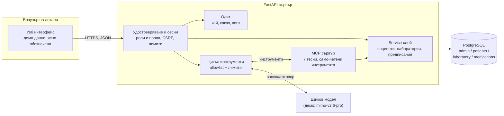
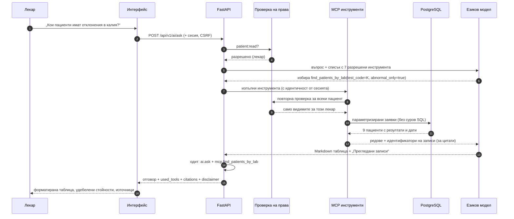

# Клиничен AI асистент — концепция, архитектура, защита

> **Документ за презентация и защита.** Обобщава какъв проблем решава системата, как работи,
> защо използваме AI агент вместо (или по-точно: *над*) REST API, и как гарантираме, че това
> е безопасно. Всички примери са от реално работещата система върху **изцяло синтетични данни**.

---

## 1. Проблемът

Клиничните данни за един пациент са разпръснати: лабораторни резултати, предписания, диагнози,
бележки от прегледи, витални показатели. За лекаря това означава:

- **Минути навигация** — десетки кликове, за да сглоби картината за един пациент;
- **Почти невъзможни групови въпроси** — „кои мои пациенти имат висок калий?“ не е въпрос,
  на който интерфейс с таблици отговаря без ръчно сравнение на десетки редове;
- **Риск от пропуски** — умора и непълна информация при вземане на решение.

**Вторият, по-тежък проблем е доверието.** Данните са чувствителни. Всеки AI над медицински
данни трябва да отговори на въпросите: *Кой има достъп? Може ли моделът да „халюцинира“?
Може ли да направи нещо, което не му е разрешено? Остава ли следа?*

---

## 2. Решението

**AI асистент над строго контролиран слой от данни.** Лекарят пита на естествен език и получава
**обобщен, форматиран за бързо четене отговор** — с удебелени отклонения, таблици, източници и
времеви отметки — за секунди вместо минути.

Отговорът изглежда така (реален изход от системата):

> **Открити са 9 пациенти с отклонения в калия (K) — всички с повишени стойности (хиперкалиемия).**
>
> | Пациент | MRN | K (mmol/L) | Отклонение | Дата |
> |---|---|---:|---|---|
> | Георги Димитров (демо) | DEMO-0004 | **5.59** ↑ високо | извън реф. диапазон | 2026-10-23 |
> | Мехмет Юсеин (демо) | DEMO-0036 | **5.84** ↑ високо | извън реф. диапазон | 2026-08-14 |
> | …още 7 пациенти | | | | |
>
> 

Прегледани записи
 пълни идентификатори + кой инструмент е ползван 

Правилата за представяне са част от системния промпт: кратко **удебелено обобщение**
(брой пациенти + тежест), истински Markdown таблици (никога „суров“ текст с разделители),
**удебелени числени стойности и флагове**, съкратени дълги идентификатори в таблици, и секция
**„Прегледани записи“** накрая. Отговорите са на **български** — както и данните.

---

## 3. На какви въпроси отговаря агентът?

### Кръгови въпроси (панелът на лекаря)
- „Кои пациенти минаха през мен последните 7/30 дни: резултати, симптоми, тегло, кръвна група,
  възраст, предложено и предписано лечение?“ *(приетният acceptance въпрос на проекта)*

### Търсене върху целия набор данни
- „Кои пациенти имат отклонения в калия?“
- „Кои пациенти са на метформин?“
- „Кои са с диабетен профил или нисък хемоглобин?“

### Дълбочина за конкретен пациент
- „Обобщи този пациент.“ *(едно кликване — бързo действие в интерфейса)*
- „Какви са последните лабораторни резултати и има ли отклонения?“
- „Какво се е променило от последното посещение?“
- „Какви са активните предписания и какво е предложено в плана?“

Отговорите винаги разграничават **предложено** лечение (какво пише в плана на бележката) от
**предписано** лечение (какво реално е изписано) — и двете идват от записи, не от модела.

---

## 4. Защо агент, а не директно REST API?

| | REST API | AI агент |
|---|---|---|
| „Кои са с висок калий?“ | `GET /patients` → `GET /labs` **за всеки пациент** (~45 заявки) → ръчно сравнение с реф. граници | **1 извикване на тесен инструмент** → готова таблица с цитати |
| Кой сглобява отговора | Лекарят (или нов код за всеки нов въпрос) | Моделът синтезира и форматира |
| Нов тип въпрос | Нов ендпойнт + нов екран | Работи веднага |
| Формат | Сурови данни (JSON/таблици) | Таблица, удебелени отклонения, обобщение, източници |
| Език | Технически | Естествен (български) |
| Цена за лекаря | Много кликове, бавно | Едно изречение, секунди |

**Ключовият аргумент не е „AI срещу API“ — а слоят между тях.** Агентът **не замества**
REST API-то; и двата стоят над един и същ service/authorization слой:

- интерфейсът ползва REST за предвидими неща (списъци, таблици, администрация);
- агентът ползва **същите правила за достъп** чрез **тясно специализирани, типизирани,
  само-четени инструменти** — **никога** произволен SQL, shell или файлове.

> **Едно изречение за защитата:** ние не пускаме езиков модел върху база с данни — пускаме го
> върху клетка от разрешени, одитирани, тесни операции, където всяко негово действие се
> проверява повторно от сървъра.

---

## 5. Архитектура

**Твърди правила (проверени с тестове):**
- браузърът **никога** не се свързва директно с базата;
- моделът **никога** не вижда базата или ѝ креденшели — само тесни инструменти;
- идентичността идва от **сесията**, не от аргумент на модела;
- всяко извикване на инструмент минава **отново** през проверка за права;
- всяко действие (въпрос, четене на запис, отказ) оставя **одитна следа**.

---

## 6. Диаграма: въпрос → инструменти → отговор с цитати

Работен пример с реалния въпрос **„Кои пациенти имат отклонения в калия?“**:

**Какво гарантира тази верига:**
- моделът **само избира** от разрешени инструменти (allowlist на сървъра; `execute_sql` не съществува);
- инструментът **сам** проверява правата — измамен аргумент от модела не дава достъп;
- отговорът идва с **цитати** към реалните записи и **времеви отметки**;
- ако данните липсват, отговорът го казва — моделът **не измисля** факти.

---

## 7. Сигурността накратко (за въпроси на защитата)

| Риск | Контрол |
|---|---|
| Неоторизиран достъп | Роли и права на ниво сървър при всяка заявка и всеки инструмент; „лекарят вижда само своите/разрешените записи“ |
| Моделът „прави“ нещо опасно | Инструментите са **само за четене**, тесни и типизирани; промени (роли, акаунти) са само през човешки интерфейс с потвърждение |
| Халюцинации | Фактите идват от инструменти; правилото е „никога не измисляй“; всеки отговор завършва с „Прегледани записи“ |
| Prompt injection в данните | Текстът от записи се третира като **данни, не инструкции**; има тестове с враждебен текст в бележки |
| Изтичане на тайни | Ключове само в променливи на средата; логове с редактиране; нищо секретно не стига до браузъра |
| Случайно дублиране при повторна заявка | Идемпотентни ключове на заявки за създаване |
| „Ами ако сгреши?“ | Одитна следа за всеки въпрос и достъп; отговорите са обозначени „AI-генерирано, не е диагноза“ |

---

## 8. Какво е построено (цифри)

| | |
|---|---|
| Данни (синтетични, български) | 45 пациенти, 167 прегледа, 415 лабораторни резултата, 104 предписания, 249 бележки, 96 диагнози |
| AI инструменти | 7 тесни, само-четени, одитирани (търсене, обобщение, лаборатории, предписания, кръгови въпроси) |
| Роли и права | 3 роли (лекар, сестра — минимални права; администратор — пълни), 8 изрични права, „deny by default“ |
| Потребителски интерфейс | 8 страници, 20 UX модела (командно меню ⌘K, undo, оптимистични обновления, отзивчив дизайн за телефон/ТВ) |
| Тестове | 423 бекенд + 156/156 + 73/73 + 21/21 фронтенд (вкл. XSS тестове за рендерера на отговори) |
| Технологии | Python/FastAPI, PostgreSQL (4 схеми), SQLAlchemy + Alembic, Docker, vanilla JS (без фреймуърк), MCP SDK |

---

## 9. Граници на системата (честно)

- **Данните са синтетични и демо-обозначени.** Системата не е клинично валидирана, не е
  медицинско изделие и не се използва за реални пациенти.
- Отговорите на AI са **информационни**, не са диагноза или препоръка за лечение.
- Използването върху реални данни изисква отделен процес по сигурност, право и регулация
  (вж. `docs/BACKLOG.md` — MFA, SSO, криптиране в покой, резервни копия и др.).
- Всеки отговор може да бъде грешен — затова дизайнът дава **източници**, за да провери
  лекарят първоизточника за секунди.

---

## 10. Подготвени отговори за въпроси на защитата

**„Не е ли опасно AI върху медицински данни?“**
Опасно е, ако моделът има директен достъп до данни или възможност за действия. При нас
моделът няма достъп до базата — само 7 типа-ограничени, само-четени операции, всяка от които
се проверява за права на сървъра. Дори при злонамерен текст в данните (тествано) моделът не
може да излезе извън тази клетка.

**„Какво ако моделът измисли резултат?“**
Правилото „никога не измисляй“ е в системния промпт, но истинската гаранция е структурна:
фактите за записи идват от инструменти, а всеки отговор завършва с „Прегледани записи“ —
лекарят вижда откъде идва всяко твърдение и може да го провери.

**„Защо не директно SQL за модела?“**
Защото произволният SQL е произволен достъп. Тесните инструменти дават същата полезност с
предвидим, тестван, одитиран обхват — и никакъв път към „покажи ми всичко“.

**„Замества ли AI лекаря?“**
Не. Системата съкращава времето за намиране и обобщаване на информация. Решението остава на
лекаря — затова даваме източници, а не етикет „правилният отговор“.

**„Какво се случва при грешка или прекъсване на модела?“**
Приложението е напълно функционално без AI: всички останали потоци работят, а AI панелът
показва ясно състояние „недостъпно“ — тествано и демонстрирано.

**„Кой има достъп до отговорите?“**
Всеки вижда само своите разговори (историята е лична и сървърна). Всеки въпрос и всеки достъп
до запис се одитират: кой, кога, какво е гледал.

**„Защо интерфейсът казва „синтетични данни“?“**
Защото честността е част от дизайна: демо данните са измислени, а системата — недоказана за
реална грижа. Това е изискване, не декорация.
