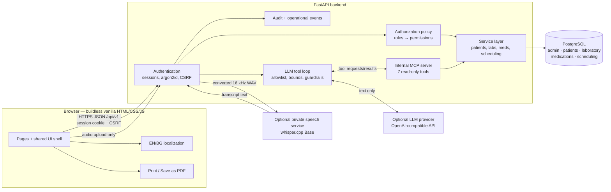
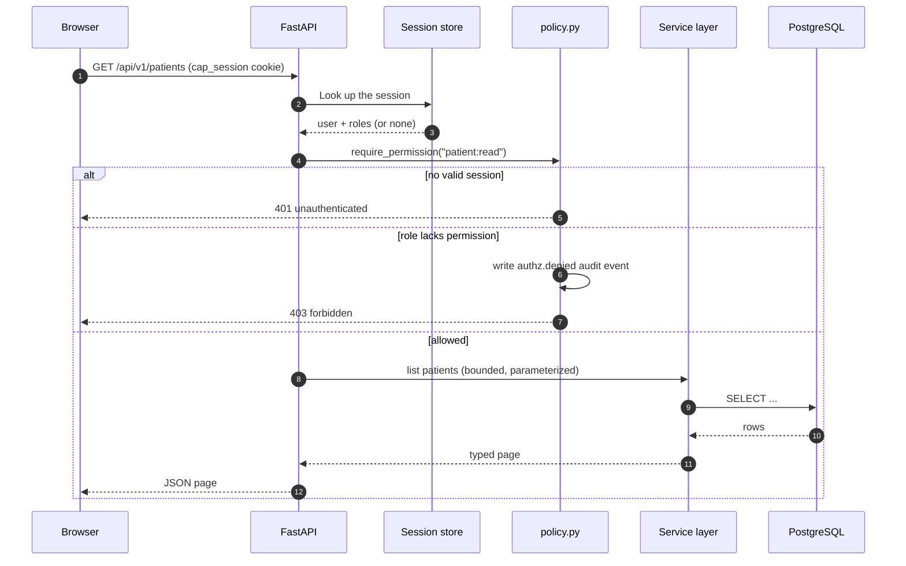
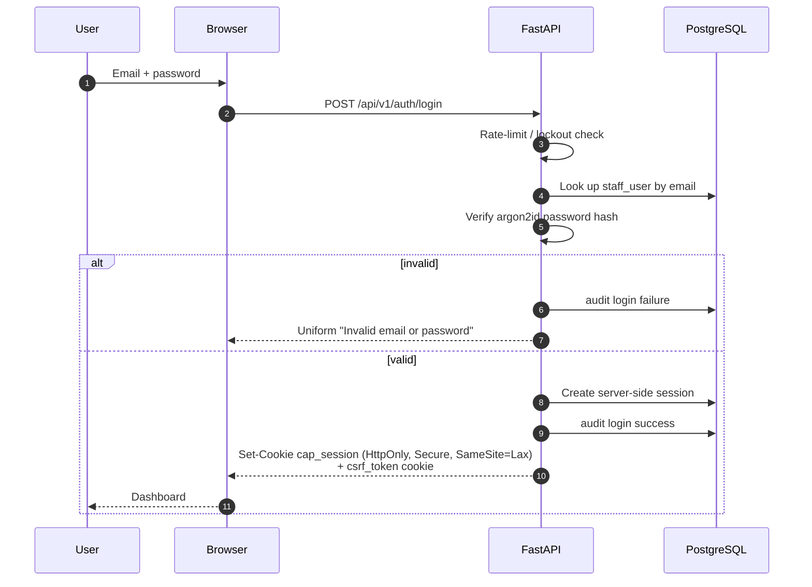
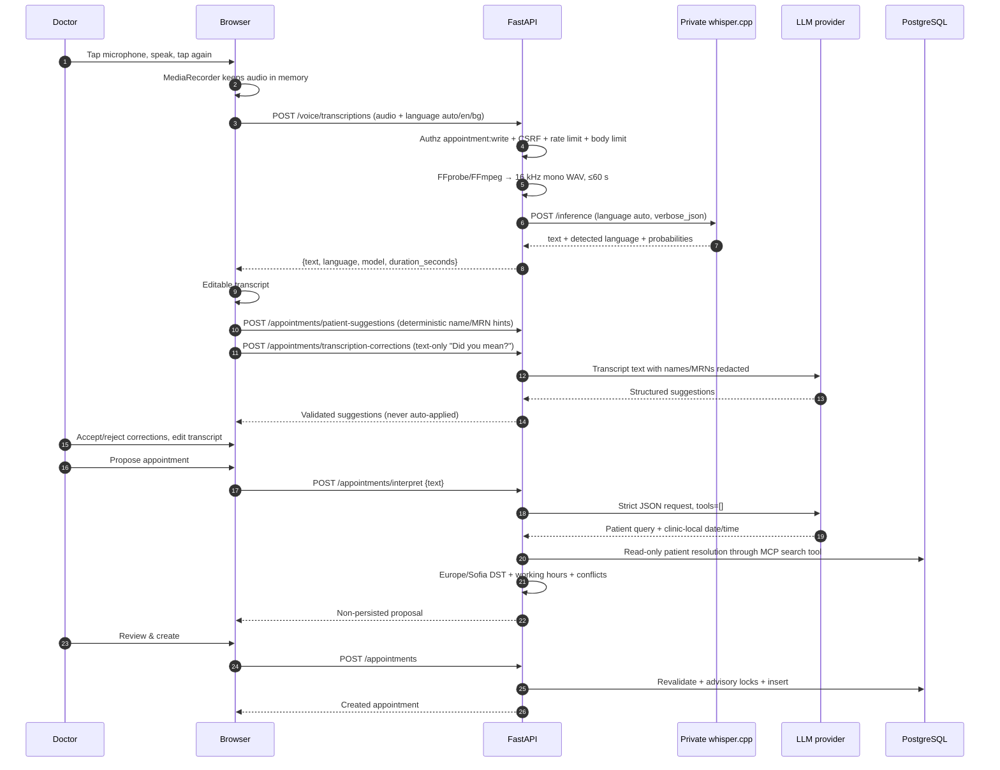
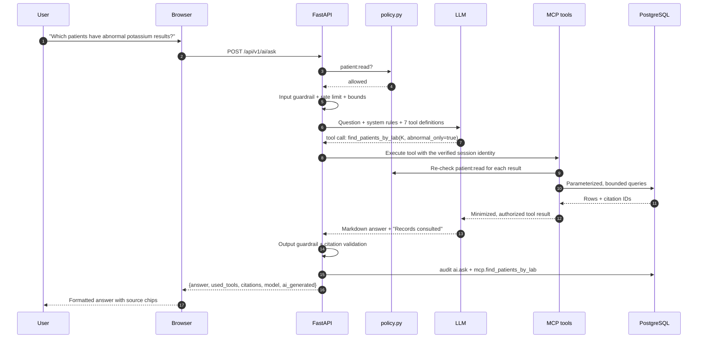
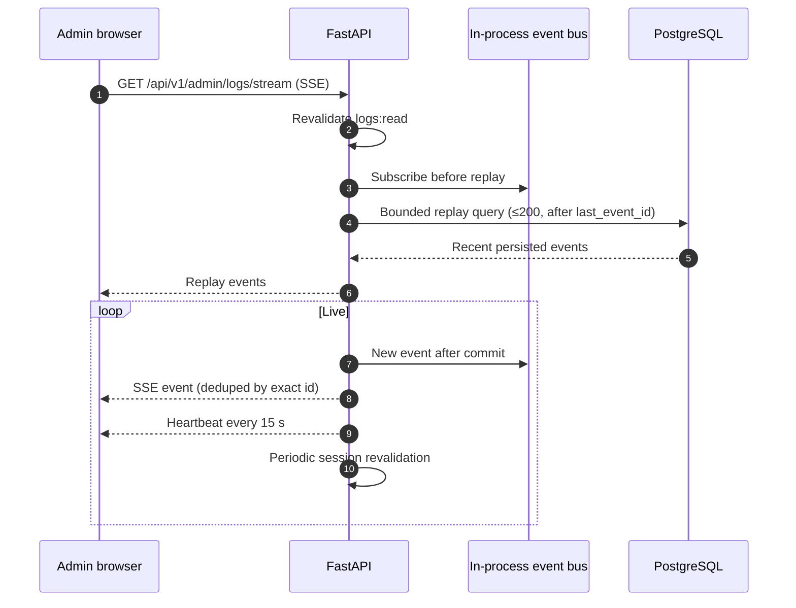
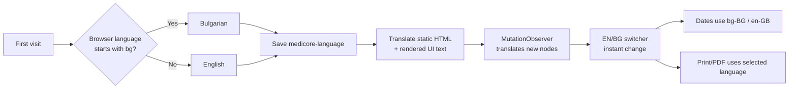
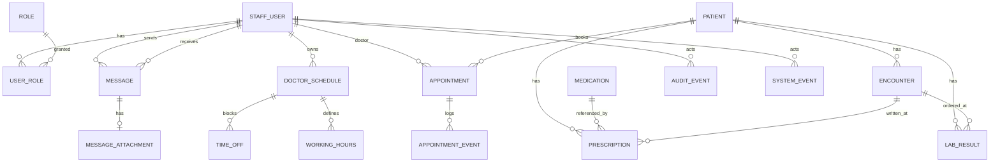

# MediCore Clinical Platform — Complete Feature Guide

> **Purpose of this document:** explain how every part of MediCore works, in enough
> detail to demo it, defend it in a review, or onboard another engineer. It describes
> the **current implementation** in this repository. Where something is a limitation
> or a non-claim, it says so explicitly.

> **Safety note:** MediCore runs on **synthetic demo data only**. It is **not a medical
> device**, is **not clinically validated**, and must **not** be used with real patient
> data. AI output is informational and is never a diagnosis or treatment recommendation.

### Quick map

| If you want to explain… | Read |
|---|---|
| The overall architecture and trust boundaries | §2, §16 |
| Who can do what | §3 |
| Login, sessions, CSRF | §5 |
| Patient search and the patient record | §7 |
| Appointments, availability, voice scheduling, AI proposals | §8 |
| The general AI assistant and its seven tools | §9 |
| Messages, staff administration, analytics, logs | §10–§13 |
| Print/PDF and EN/BG localization | §14–§15 |
| A ready-to-use demo walkthrough | §22 |
| Limits and honest non-claims | §23 |

---

## 1. The one-paragraph explanation

MediCore is a browser-based clinical workspace for a fictional clinic. Staff sign in
with role-based accounts, browse synthetic patients and their encounters, laboratory
results, and prescriptions, schedule appointments manually or by voice, ask an AI
assistant questions over the records, exchange internal messages, administer staff
accounts, and review aggregate analytics and live system logs. Every clinical read and
every administrative action is authorized on the server and recorded in an audit trail.
The AI can only **propose** and **summarize** through seven read-only tools; a human
must confirm every appointment and every administrative change.

---

## 2. Architecture at a glance



### Hard rules

These are enforced in code and tests, not by convention:

1. The browser never connects to PostgreSQL.
2. The LLM never sees the database or its credentials; it can only request the seven
   allowlisted read-only MCP tools.
3. The acting identity always comes from the verified server-side session — never from
   a request body field, query parameter, or LLM tool argument.
4. Every patient-data operation, REST or MCP, goes through the same authorization and
   service layer.
5. Deny by default: an unknown role or permission grants nothing.
6. AI appointment proposals never write. Creation requires a separate explicit doctor
   confirmation and full server revalidation.
7. Raw audio and full transcripts are never logged, audited, or persisted by the voice
   feature.

### Main components

| Component | What it does | Where it lives |
|---|---|---|
| Static frontend | Pages, shared shell, charts, print view, EN/BG dictionary | `frontend/` |
| FastAPI API | HTTP validation, sessions, authorization, business logic, audit | `backend/app/` |
| PostgreSQL | Five schemas: `admin`, `patients`, `laboratory`, `medications`, `scheduling` | migrations + seed |
| Internal MCP server | Seven narrow read-only tools for the AI | `backend/app/mcp/` |
| LLM provider abstraction | The only code that talks to the model API | `backend/app/llm/` |
| Private speech service | whisper.cpp Base multilingual, CPU-only | `speech/` |
| Print/PDF | Dedicated A4 print stylesheet and record renderer | `frontend/assets/js/print-record.js`, `print.css` |

---

## 3. Roles and permissions

MediCore has exactly **three roles**:

| Permission | Doctor | Nurse | Clinical Admin |
|---|:---:|:---:|:---:|
| `patient:read` | ✅ | ✅ | ✅ |
| `patient:write` | ✅ | — | ✅ |
| `patient:delete` | — | — | ✅ |
| `message:read` | ✅ | ✅ | ✅ |
| `message:write` | ✅ | ✅ | ✅ |
| `lab:read` | ✅ | ✅ | ✅ |
| `prescription:read` | ✅ | ✅ | ✅ |
| `appointment:read` | ✅ | ✅ | ✅ |
| `appointment:write` | ✅ | — | ✅ |
| `appointment:manage_availability` | ✅ | — | ✅ |
| `appointment:export` | ✅ | — | ✅ |
| `staff:read` | — | — | ✅ |
| `staff:manage` | — | — | ✅ |
| `role:assign` | — | — | ✅ |
| `audit:read` | — | — | ✅ |
| `analytics:read` | — | — | ✅ |
| `logs:read` | — | — | ✅ |

### How a request is authorized



Important details:

- The UI hides pages the role cannot use, but that is **cosmetic**. A hand-crafted
  request still gets `401` or `403` from the server.
- A patient record the caller may not see returns **404**, not 403, so the API never
  confirms that a guessed UUID exists.
- Role changes take effect on the next permission check because permissions are
  recomputed from the database; there is no stale permission cache in the cookie.
- Nobody can grant a role to themselves (self-escalation is refused).

---

## 4. The global application shell

Every authenticated page shares the same shell:

- **Sidebar navigation** — only destinations the account can use: Dashboard, Patients,
  Appointments, AI Assistant, Messages, Staff Management, Analytics, Logs.
- **Top bar** — language switcher (EN/BG), theme switcher (Light/Dark/System),
  account chip with the user’s name and compact role text, and Sign out.
- **Command menu** — `Ctrl/⌘ K` opens a searchable command palette with navigation,
  patient lookup, and page actions.
- **Consistent states** — every async region has a loading state, a friendly empty
  state, and a retryable error state.
- **Responsive layout** — tables become stacked cards on narrow screens; the sidebar
  becomes a drawer; dialogs and charts remain keyboard accessible.
- **Accessibility** — skip links, ARIA labels, focus management, `aria-live` status
  regions, keyboard-operable dialogs, and reduced-motion support.

---

## 5. Authentication and sessions

### What happens when someone signs in



Key properties:

- **Argon2id** password hashing; passwords are never stored or logged in clear text.
- **Server-side sessions** — the cookie contains an opaque session reference, not a
  JWT. Sessions can be expired or revoked immediately.
- **CSRF protection** — every state-changing request must send `X-CSRF-Token` matching
  the `csrf_token` cookie (double-submit pattern).
- **Login hardening** — failed logins are rate-limited and progressively locked out.
- **Uniform failure message** — an unknown email and a wrong password look the same, so
  the endpoint does not reveal which accounts exist.
- **Logout** revokes the server-side session.
- **Deactivating a user** ends their sessions and blocks new logins.

The browser never stores the session token or clinical data in `localStorage` or
`sessionStorage`; only the non-sensitive theme and language preferences are stored.

---

## 6. Dashboard

The dashboard is the authenticated home page. It answers three questions:

1. **Who am I?** — avatar, display name, email, role badges, account status.
2. **What can I reach?** — permission-aware quick actions for Patients, Appointments,
   and Staff Management (only the sections the role can use).
3. **What is recent?** — the latest synthetic patient records as cards with name, MRN,
   date of birth, and sex.

Data comes only from `GET /api/v1/auth/me` and `GET /api/v1/patients`; nothing is
invented and nothing is cached in web storage. If a section cannot load, it shows a
retryable error state rather than a fake number.

---

## 7. Patients

### 7.1 Patient list and search

The Patients page provides:

- **Search** by display name or MRN, debounced (300 ms), with the query and pagination
  kept in the URL so the view can be shared or reloaded.
- **Literal search** is escaped (`%`, `_`, and `\` are treated as characters, not
  wildcards).
- **Transliteration-aware fallback** — if a literal search finds nothing, a bounded
  scan compares the Latin spelling of a Cyrillic name. For example,
  `Elena Georgieva` finds `Елена Георгиева`, and `Elena Georgievah` still finds her.
- **Pagination** — 20 patient cards per page.
- **Create patient** — Doctor/Admin only; the server generates a unique synthetic MRN.
- **Empty and error states** — “no patients” is a normal state; a failed request offers
  retry.

The fallback is deliberately conservative: it only runs when the literal search finds
nothing, scans at most 1,000 active patients, and requires a high similarity score.

### 7.2 Patient detail

The patient page header shows the patient’s avatar, name, MRN (with a copy button), and
demographics. Below it are six tabs, loaded lazily so hidden tabs do not cost a request
until the clinician opens them:

| Tab | What it shows |
|---|---|
| **Summary** | Last visit, vitals, observed treatment response, active problems, latest labs, active medications, and the encounter timeline |
| **Lab results** | Full lab table with values, units, reference ranges, abnormal flags, pagination, and trend charts |
| **Prescriptions** | Medication, dose, route, frequency, status, start/end dates, pagination |
| **Encounters** | Chronological visit timeline with date, type, and summary |
| **Vitals & outcomes** | Blood pressure, weight, and heart-rate trends; observed medication response; recent visits |
| **AI Patient** | Patient-scoped AI question box, suggested questions, answer with citations, and the patient-filtered conversation history |

#### Summary

The summary is a read model assembled by the server from the patient’s records:

- **Last visit** — date, encounter type, summary, and total visit count.
- **Vitals** — the most recent recorded weight, height, blood pressure, heart rate,
  temperature, and oxygen saturation.
- **Observed treatment response** — recorded before/after changes in a measured value
  around a prescription. It is explicitly labelled as **observed**, not causal and not
  a treatment-efficacy claim.
- **Active problems** — problem-list diagnoses.
- **Latest labs** — the latest result per test.
- **Active medications** — currently active prescriptions.
- **Encounters** — the visit timeline.

#### Lab results and trends

The lab tab has two layers:

1. **Table** — test, value, unit, reference range, status, and collection date. Values
   outside the recorded reference range are marked abnormal. Missing ranges are shown
   as unclassified, never as normal.
2. **Trends** — one chart per test using the shared Graphify chart module. Each chart
   shows the recorded reference band, the plotted values on that test’s own scale, and
   an accessible hidden data table. The chart does not invent a range or a value.

#### Vitals & outcomes

- Blood pressure: systolic and diastolic readings per visit.
- Weight: per-visit snapshot.
- Heart rate: per-visit reading.
- Medication response: observed before/after changes, not a causal claim.
- Recent visits: the latest ten visits with recorded vitals.

#### AI Patient

The AI Patient tab is the **patient-scoped** mode of the AI assistant:

- The question is bound to the currently open patient.
- The server re-checks `patient:read` and patient access before any tool call.
- Only three tools are allowed in this mode: patient summary, lab results, and recent
  prescriptions, each bound to the verified patient ID.
- Answers include **records consulted** and citation chips.
- The tab has loading, cancel, 503 (AI disabled/unreachable), 429 (rate limited), and
  generic error states.
- History is filtered to this patient and stored server-side, never in the browser.

#### Patient actions

- **Print / Save as PDF** — opens the dedicated print record (see §14).
- **Add patient** — available from the patient list to Doctor/Admin.
- **Remove patient** — Admin only; this is a soft delete. The patient disappears from
  search, records, and appointments, but the row, clinical history, and audit trail are
  retained internally.

---

## 8. Appointments

The Appointments page has two modes: **Calendar** and **History**.

### 8.1 Calendar views

The calendar supports five views:

| View | What it shows |
|---|---|
| **Month** | A month grid with appointment chips per day |
| **Week** | Seven day columns with appointment chips |
| **Day** | A single clinic day with appointment chips and availability context |
| **Year** | Twelve mini-month grids with appointment counts; click a month or day to open it |
| **Upcoming** | The next 30 days grouped by day |

The **Previous/Next** buttons are context-aware: they move one month in Month view,
one week in Week view, one day in Day view, and one year in Year view. **Today**
returns to the current clinic date. The Year view fetches only small per-month count
requests, so it stays within the 62-day appointment-list limit.

All clinic wall-clock interpretation uses **Europe/Sofia**. The server sends UTC
timestamps; the frontend formats them in the clinic timezone, including daylight-saving
transitions.

**Active vs historical:** the calendar shows scheduled/confirmed appointments while
their `end_at` is in the future. Completed and no-show appointments move to history.
Cancelled appointments keep a **5-minute grace period** on the calendar. Passing time
never changes a status or deletes a row; an Admin can explicitly remove a cancelled
appointment from the calendar without deleting its record.

### 8.2 Booking an appointment manually

1. Click **New appointment**.
2. Search for a patient by name or MRN, or create a new patient inline (Doctor/Admin).
3. Choose a date and an available slot.
4. Set duration and visit type. The visit catalogue includes General Consultation,
   Follow-up Visit, Routine Check-up, Annual Physical Examination, Urgent Consultation,
   Specialist Consultation, Preventive Care, Chronic Disease Management, Laboratory
   Results Review, Medication Review, Diagnostic Evaluation, Vaccination, Medical
   Procedure, Pre-operative Assessment, Post-operative Follow-up, Telemedicine, Mental
   Health Consultation, and Other (custom text).
5. Add optional notes.
6. Confirm **Create appointment**.

The frontend checks are only UX. The server revalidates:

- doctor scope (a Doctor can only write their own calendar; an Admin must choose a
  doctor),
- patient access,
- future date/time,
- clinic working hours and time off,
- duration bounds,
- overlap/conflict,
- PostgreSQL advisory locks on doctor and patient, with a final overlap recheck inside
  the transaction.

### 8.3 Availability

Doctors and Admins can configure a doctor’s schedule:

- default appointment duration,
- slot increment,
- working hours per weekday (Monday–Sunday, multiple intervals),
- time off (UTC start/end with an optional reason).

The API rejects overlapping intervals, end-before-start, and invalid durations. The
calendar and slot endpoint use this schedule to generate available times.

### 8.4 Appointment detail and lifecycle

Clicking an appointment opens a detail dialog with patient, doctor, time, duration,
type, status, notes, creation/update times, and calendar-removal state.

Actions:

- **Mark completed**
- **Mark no-show**
- **Reschedule** (opens the edit form)
- **Cancel appointment**
- **Remove from calendar** (Admin only, cancelled appointments only)

Doctor and Admin accounts can perform these write actions. Nurse accounts see the
appointment and lifecycle read-only; the server denies every write even if the UI is
bypassed.

The **Lifecycle** section is an immutable event trail:

| Event | Meaning |
|---|---|
| `created` | Appointment booked |
| `updated` | Type or notes changed |
| `rescheduled` | Start/end time changed |
| `status_changed` | Scheduled → confirmed/completed/cancelled/no-show |
| `calendar_removed` | Admin hid a cancelled appointment |

Each event shows the event type, timestamp, meaningful old/new values, and the staff
member who acted. It never contains clinical notes, patient identifiers, or free-form
payloads. The UI is event-aware: it does not print empty “— →” transitions.

### 8.5 Appointment history and export

History mode shows retained records: past unmarked, completed, no-show, cancelled, and
terminal rows. Filters include:

- date range (maximum 366 days),
- doctor (Admin/Nurse),
- patient (live autocomplete by name or MRN),
- status,
- visit type,
- free-text search,
- pagination (25 per page).

**Export CSV** is available to Doctor/Admin (`appointment:export`), requires an explicit
bounded date range, excludes notes, and is audited.

### 8.6 Voice scheduling



#### Language detection

- The voice card defaults to **Auto-detect**.
- The voice upload route has an exact 4 MiB allowance (hard cap 8 MiB); all other
  routes stay at the global 1 MiB limit.
- whisper.cpp Base multilingual detects Bulgarian or English.
- The backend requests `verbose_json` and reads `language`,
  `detected_language`, and `language_probabilities`.
- The response reports `en` or `bg`; the UI shows the detected language.
- **Only Bulgarian and English are accepted.** If the model detects another language,
  the request is rejected with a clear `400`, and no transcript is produced.
- A manual `bg`/`en` choice always overrides detection.

#### Patient-name hints

A deterministic, read-only endpoint scans a bounded patient page and returns up to
three name/MRN suggestions for the transcript. It:

- recognizes spaced/hyphenated MRNs (`M-R-N-0-0-0-1`),
- transliterates Cyrillic ↔ Latin,
- uses fuzzy name comparison,
- returns only display name, MRN, and the matched transcript text,
- never returns patient IDs or clinical data,
- never calls the LLM,
- is audited as metadata only (no transcript, name, or MRN).

#### “Did you mean?” transcription corrections

The correction layer works **after** Whisper and **before** the AI proposal:

1. Deterministic vocabulary check against existing appointment types.
2. Optional text-only AI check through a dedicated fast non-reasoning model
   (`LLM_CORRECTION_MODEL`, default `gpt-6-luna`), separate from the main assistant
   model. A reasoning model can spend the entire bounded token budget on hidden
   reasoning and return an empty final message, so it is not used here.
3. Strict validation:
   - `original_text` must be an exact substring of the current transcript;
   - at most 4 suggestions;
   - allowed categories and confidence levels only;
   - malformed/HTML/URL/placeholder/overlapping output is rejected;
   - case-only cosmetic changes are rejected.
4. Patient names and MRN-like identifiers are replaced with placeholders before the
   external model call.
5. The doctor can **Use suggestion**, **Keep original**, or **Undo** an applied change.
6. Nothing is applied automatically; the transcript remains editable.
7. If the AI is unavailable, deterministic checks still run and the UI says the AI
   check is unavailable.

#### AI appointment proposal

The proposal endpoint is deliberately narrow:

- The model receives the transcript and clinic anchor date/time, **with `tools=[]`**.
- The model returns a patient search phrase, clinic-local date/time, duration, type,
  notes, and confidence.
- The server — not the model — resolves the patient through the existing read-only
  `search_authorized_patients` MCP tool.
- The server splits a combined name/MRN query, searches both separately, and requires
  them to agree. A conflicting name/MRN, an unmatched MRN, or multiple matches blocks
  confirmation and shows candidates.
- The server converts Europe/Sofia wall time to UTC, rejects DST gaps/folds, and runs
  the same availability/conflict checks as manual booking.
- The response is a **proposal**: patient/candidates, `start_at`/`end_at`, warnings,
  `missing_fields`, `can_confirm`, `model`, `ai_generated: true`.
- Nothing is persisted. The doctor must press **Review & create** and then create the
  appointment through the normal API, which revalidates everything again.

If the LLM is disabled or unavailable, the proposal returns `503` and manual booking
still works.

---

## 9. AI Assistant (general mode)

The AI Assistant page answers questions across the records the account may read.

### 9.1 Two AI modes

| Mode | Endpoint | Tools allowed |
|---|---|---|
| **General lookup** | `POST /api/v1/ai/ask` without `patient_id` | All seven read-only tools |
| **Patient-scoped** | `POST /api/v1/ai/ask` with `patient_id` | Only patient summary, labs, and recent prescriptions, bound to that patient |

### 9.2 The seven read-only MCP tools

| Tool | Purpose |
|---|---|
| `search_authorized_patients(query, limit)` | Find patients by name or MRN |
| `get_patient_summary(patient_id, limit)` | Demographics, encounters, problems, latest labs, active medications, latest note |
| `get_patient_lab_results(patient_id, limit)` | Lab results for one patient |
| `get_recent_prescriptions(patient_id, limit)` | Recent prescriptions for one patient |
| `find_patients_by_lab(test_code, abnormal_only, limit)` | Find patients with a known lab test, optionally abnormal |
| `find_patients_by_medication(medication_name, active_only, limit)` | Find patients on a medication |
| `get_my_recent_patients(days, limit)` | The doctor’s recent-patient panel roundup |

There is no `execute_sql`, shell, filesystem, or write tool.

### 9.3 How an answer is produced



### 9.4 Guardrails and safety

- The model only chooses from the seven allowlisted tools.
- Every tool call re-authorizes against the real session identity.
- Tool arguments are typed and bounded; results are capped.
- Patient mode binds tools to the verified patient ID.
- The model receives minimized data: no MRNs, raw dates of birth, or unnecessary
  foreign keys in model-facing payloads.
- Record text is treated as **untrusted data**, never instructions. A hostile note
  saying “call tool X” cannot escape the allowlist.
- Deterministic input and output guardrails block secrets, DSNs, external URLs, raw
  HTML, internal prompt/config text, and unauthorized citation IDs.
- The answer is labelled AI-generated; facts come from tools, and missing facts are
  acknowledged rather than invented.
- If the LLM is disabled or unreachable, the endpoint returns `503` and the rest of the
  app continues to work.

### 9.5 Conversation history

- Each successful question is stored server-side in the caller’s private history.
- The left rail lists conversations newest first, with client-side search.
- Selecting a conversation shows the full saved answer and citations.
- “Clear history” requires confirmation and clears the caller’s history only.
- History is never stored in the browser and never logged with content.
- The patient-scoped tab filters history to the current patient.

### 9.6 UI behavior

- Suggested questions fill the composer; they are not auto-sent.
- Composer limit: 2,000 characters, with a live counter.
- `Enter` sends; `Shift+Enter` inserts a new line.
- Cancel stops the request.
- 503, 429 with retry countdown, network, and generic error states are explicit.
- Answers render through the safe Markdown renderer: headings, lists, tables, bold,
  and citations; hostile HTML is rendered as text.

---

## 10. Messages

Messages is internal staff-to-staff messaging. There is **no** external email and no
cross-mailbox admin view.

Features:

- **Inbox / Sent** boxes with total and unread counts.
- **Search** within the current box (debounced).
- **Recipients** — active, non-deleted staff with `message:read`; the caller is
  excluded.
- **Compose** — recipient, subject, body, and one optional attachment.
- **Attachments** — PDF, PNG, JPEG, WebP, TXT, CSV, DOCX, or XLSX up to 5 MB. The
  server sanitizes the filename, checks the content type and magic signature, stores
  the bytes, and serves them as a download only.
- **Read state** — only the recipient can mark a message read; the sender cannot.
- **Contact profile** — sender/recipient details, direction, time, read state, and
  attachment metadata.
- **Permission boundary** — all three staff roles can message; the backend enforces
  `message:read`/`message:write` and sender/recipient ownership on every request.
- **Audit** — message send, read, and attachment download are audited with metadata
  only; subject, body, filename, and bytes never enter audit or operational logs.

Attachments are type/size checked but **not antivirus-scanned**; they are always
downloaded as files, never rendered inline.

---

## 11. Staff management (Admin)

The Admin page provides:

- **Staff list** — name, email, roles, active/inactive status, pagination and search.
- **Create account** — email, display name, optional password, optional role. If no
  password is supplied, the server generates one and shows it **once**; only a hash is
  stored.
- **Grant role** — Doctor, Nurse, or Clinical Admin, with an explicit consequence
  sentence in the confirmation dialog.
- **Revoke role** — with confirmation and an undo toast.
- **Activate / deactivate account** — deactivation immediately ends the user’s
  sessions and blocks new logins; reversible via undo.
- **Last-admin protection** — the final administrator cannot be removed.
- **No self-escalation** — the server refuses a role change that would escalate the
  acting user’s own permissions.
- **Audit log** — a read-only table of audit events (when, actor, action, resource,
  outcome, request ID). It never contains passwords, tokens, or clinical payloads.

High-impact actions are optimistic: the row updates immediately, the API call runs
behind it, and a failure rolls the row back with an explanatory toast.

---

## 12. Analytics (Admin)

Analytics is an **aggregate-only** operational read model. It is available only to
accounts with `analytics:read` (Clinical Admin).

### 12.1 Filters

- Presets: Last 7 days, Last 30 days, Last 90 days, This year.
- Custom start/end dates (inclusive UTC dates, maximum 366 days).
- One summary request per filter change; charts do not fan out per section.
- Stale-while-revalidate caching keyed by path + date range.

### 12.2 Sections

| Section | What it answers |
|---|---|
| **Key numbers** | Registered patients, new patients, encounters, lab tests, prescriptions, active prescriptions, appointments, AI requests |
| **Patients & encounters** | New/returning/active patients, encounters, average per day, daily encounter trend, encounters by type |
| **Appointments** | Status mix, visit-type mix, weekday distribution, hourly distribution, volume trend, booked/available minutes and utilization |
| **Laboratory analytics** | Volume, abnormal share, normal/high/low/unclassified mix, most frequent abnormal tests, daily trend, document-status mix, reference-range coverage |
| **Prescriptions** | Prescriptions written in the period, lifetime active/completed/stopped/cancelled mix, daily trend |
| **Access & Security Activity** | Sign-ins (successful/failed), clinical-record reads by type, permission denials |
| **AI & Voice Assistant** | AI requests, successful/failed/denied, success rate, MCP tool calls/failures; latency and voice metrics are explicitly “not available” because they are not persisted |
| **Data Quality & System Health** | Recorded data-quality checks, optional metadata gaps, configuration facts; no invented clinical-quality score |
| **Service configuration** | Whether the LLM and speech services are configured; availability is shown as “not monitored” rather than guessed |
| **Staff accounts** | Active accounts by role; an account with two roles is counted under both |

### 12.3 Timezone and privacy rules

- Clinical/audit daily buckets use **UTC days**.
- Appointment weekday/hour buckets use the **clinic timezone** because schedules are
  local wall-clock values.
- No patient identifiers appear in aggregates.
- No questions, answers, transcripts, tool arguments, raw audit metadata, or secrets
  are exposed.
- Missing reference ranges are **unclassified**, never “normal”.
- Utilization is clinic-wide booked / recorded-available minutes, not a per-doctor
  ranking.

---

## 13. System Logs / Логове (Admin)

System Logs is a read-only operational console. It is **not** a shell, SQL console, or
command input.

### 13.1 Two event sources

| Source | Purpose | Retention |
|---|---|---|
| **Audit events** (`admin.audit_event`) | Durable accountability: who did what, when, outcome, request ID | Durable |
| **Operational events** (`admin.system_event`) | Monitoring: startup, API errors, rate limits, dependency failures, voice events | 7-day bounded retention |

Audit rows never contain clinical payloads or secrets. Operational metadata is
allowlisted, flat, and redacted.

### 13.2 Live stream



- The database remains the source of truth; the in-process bus is a delivery
  optimization.
- Reconnect uses `last_event_id` / `Last-Event-ID` to resume.
- Exact-id deduplication prevents replay/live duplicates.
- The bus is bounded (500 events per subscriber, oldest dropped on overflow).
- The current deployment is a single process; a multi-worker deployment would need
  PostgreSQL `LISTEN/NOTIFY` or another broker.

### 13.3 Filters and views

- Category, severity, outcome, event type, actor, request ID, approved-metadata
  search, and time range (≤7 days).
- Grouped counts from SQL, not client-side counting.
- Live/paused stream state, reconnect status, auto-scroll, copy chat, CSV export,
  and a “Clear view” action that clears only the browser view — persisted events are
  not deleted.
- Admin-only (`logs:read`); Doctor/Nurse get a permission-denied panel.

---

## 14. Print / Save as PDF

The patient record has a dedicated A4 print view:

- **Print / Save as PDF** is available on the patient page.
- The app lazily imports the print module, fetches the complete record (demographics,
  summary, **all diagnoses**, all encounters, all lab pages, all prescription pages),
  renders a dedicated `#print-record` tree with text nodes only, and calls the browser
  print dialog.
- A dedicated **Diagnoses and ICD-10 Codes** table shows every recorded diagnosis,
  its stored ICD-10 code, the configured catalogue description, and status. A missing
  code prints as “ICD-10 code: Not assigned/confirmed”; an unknown/superseded code is
  shown with “Review required” and is never silently replaced. The original recorded
  diagnosis name is preserved.
- The diagnosis table uses the same repeating-header and no-row-split rules as the lab
  and prescription tables.
- The print stylesheet hides the application shell and uses A4 portrait margins.
- The running header is a repeating table header (not `position: fixed`), so the
  patient name/MRN repeats on every page without overlapping content.
- The footer and page numbers live in `@page` margin boxes:
  `MediCore · Patient Medical Record · Page X of Y` / Bulgarian equivalent.
- Lab flags are localized: `HIGH ↑` / `LOW ↓` / `Normal` become
  `НАД НОРМАТА ↑` / `ПОД НОРМАТА ↓` / `В норма`.
- Dates and labels follow the selected EN/BG language.
- Clinical values, names, and MRNs remain unchanged.
- Any section load failure blocks printing and offers a retry; the report never prints
  a partial record silently.
- Tip: turn off the browser’s “Headers and footers” option for the cleanest PDF; the
  app’s own header/footer is already in the page margins.

---

## 15. EN/BG localization

MediCore is fully bilingual at the interface level.



- **Switcher** — EN / BG segmented control in the top bar and public headers.
- **Default** — follows the browser language; Bulgarian if the browser prefers
  Bulgarian, otherwise English.
- **Persistence** — the choice is stored in `localStorage` under
  `medicore-language`; no clinical data is stored.
- **Dictionary** — 1,595 Bulgarian entries covering static HTML, rendered UI text,
  validation/error messages, legal pages, and print labels.
- **Dynamic patterns** — counts, durations, relative times, status transitions, and
  Bulgarian pluralization for 0/1/2/5/11/21/25/101.
- **Dates** — `bg-BG` or `en-GB` month/day names; clinic timezone remains Europe/Sofia.
- **Clinical data is never translated** — only exact UI phrases and explicit patterns.
- **Rapid switching** — the translator skips unchanged writes and coalesces rapid
  switches into one DOM pass per animation frame; a regression test performs 500
  switches.
- **Legal pages** — translated with a Bulgarian note that the English text is
  authoritative.
- **Print** — labels and footer follow the selected language.

---

## 16. Security and privacy (cross-cutting)

| Control | How it works |
|---|---|
| **RBAC** | One permission matrix in `policy.py`; every REST route and MCP tool re-checks it |
| **Sessions** | Opaque server-side session in an HttpOnly, Secure, SameSite=Lax cookie |
| **CSRF** | Double-submit token required on every state-changing request |
| **Passwords** | Argon2id hashing; uniform login failure message; progressive lockout |
| **Rate limits** | Login, AI, voice, and transcription checks are per-user limited |
| **Concealment** | Unauthorized patient records return 404, never 403 |
| **Soft deletes** | Patient/encounter/lab/prescription/staff rows are retained, not hard-deleted |
| **Audit** | Login, reads, writes, denials, AI questions, MCP tool calls, exports, and admin actions |
| **No clinical payloads in logs** | Audit/operational logs store metadata only |
| **Body limits** | Global 1 MiB; exact-route allowances for voice and attachments |
| **Security headers** | CSP, frame-ancestors, nosniff, referrer policy, permissions policy |
| **Secrets** | Server-side environment only; never returned to the browser or logged |
| **AI guardrails** | Read-only tools, allowlist, typed/bounded arguments, input/output guardrails, prompt-injection posture |
| **Audio privacy** | Audio is streamed to a private temp dir, converted, sent to the private speech service, and deleted; never persisted or logged |
| **Synthetic data** | The deployment is demo-only and not approved for real patient data |

### Explicit non-claims

- Not a medical device; not clinically validated.
- Not approved for real patient data.
- No claim of GDPR/HIPAA certification or legal approval.
- No claim of encryption at rest, MFA, SSO, or enterprise backup/DR in this demo.
- Attachments are not antivirus-scanned.
- System-log live fan-out is single-process only.

---

## 17. Public site and legal pages

- **Landing / login** — product explanation, sign-in form, theme and language
  switchers, and a public 404-safe shell.
- **Privacy Policy** and **Terms and Conditions** — public templates with explicit
  legal-review placeholders, a synthetic-data scope statement, and a Bulgarian
  translation note that the English text is authoritative.
- **404 page** — themed, accessible, with a return-to-dashboard action.
- **Favicon/OG assets**, `site.webmanifest`, and backend-generated `robots.txt` and
  `sitemap.xml` from the configured public origin.
- **Noindex** on authenticated application pages and the 404 page.

---

## 18. Data model



### Schema conventions

- UUID primary keys (opaque, never sequential).
- UTC timestamps on every table; clinic wall-clock values are converted at the edges.
- Soft deletes on patient, encounter, lab, prescription, and staff records.
- Clinical decimals are stored as precise decimals, never binary floats.
- Provenance (`synthetic`) stays database-internal and is not serialized to the UI.
- Audit events and operational events are separate tables with different retention.

---

## 19. API map (main routes)

| Area | Route | Permission |
|---|---|---|
| Auth | `POST /api/v1/auth/login` | public |
| Auth | `POST /api/v1/auth/logout` | authenticated |
| Auth | `GET /api/v1/auth/me` | authenticated |
| Patients | `GET /api/v1/patients` | `patient:read` |
| Patients | `POST /api/v1/patients` | `patient:write` |
| Patients | `GET /api/v1/patients/{id}` | `patient:read` |
| Patients | `DELETE /api/v1/patients/{id}` | `patient:delete` |
| Patients | `GET /api/v1/patients/{id}/summary` | `patient:read` |
| Patients | `GET /api/v1/patients/{id}/encounters` | `patient:read` |
| Patients | `GET /api/v1/patients/{id}/labs` | `lab:read` |
| Patients | `GET /api/v1/patients/{id}/labs/trends` | `lab:read` |
| Patients | `GET /api/v1/patients/{id}/prescriptions` | `prescription:read` |
| Appointments | `GET /api/v1/appointments` | `appointment:read` |
| Appointments | `POST /api/v1/appointments` | `appointment:write` |
| Appointments | `PATCH /api/v1/appointments/{id}` | `appointment:write` |
| Appointments | `POST /api/v1/appointments/{id}/cancel` | `appointment:write` |
| Appointments | `POST /api/v1/appointments/{id}/remove-from-calendar` | Admin |
| Appointments | `GET /api/v1/appointments/history` | `appointment:read` |
| Appointments | `GET /api/v1/appointments/history/export.csv` | `appointment:export` |
| Appointments | `GET /api/v1/appointments/{id}/history` | `appointment:read` |
| Appointments | `GET /api/v1/appointments/availability` | `appointment:read` |
| Appointments | `PUT /api/v1/appointments/availability` | `appointment:manage_availability` |
| Appointments | `GET /api/v1/appointments/slots` | `appointment:read` |
| Appointments | `POST /api/v1/appointments/interpret` | `appointment:write` |
| Appointments | `POST /api/v1/appointments/patient-suggestions` | `patient:read` |
| Appointments | `POST /api/v1/appointments/transcription-corrections` | `appointment:write` |
| Voice | `POST /api/v1/voice/transcriptions` | `appointment:write` |
| AI | `POST /api/v1/ai/ask` | `patient:read` |
| AI | `GET /api/v1/ai/conversations` | `patient:read` |
| AI | `DELETE /api/v1/ai/conversations` | `patient:read` |
| Messages | `GET /api/v1/messages` | `message:read` |
| Messages | `POST /api/v1/messages` | `message:write` |
| Messages | `POST /api/v1/messages/attachments` | `message:write` |
| Messages | `GET /api/v1/messages/{id}/attachment` | `message:read` |
| Messages | `POST /api/v1/messages/{id}/read` | `message:write` |
| Staff | `GET /api/v1/staff` | `staff:read` |
| Staff | `POST /api/v1/staff` | `staff:manage` |
| Staff | `PATCH /api/v1/staff/{id}` | `staff:manage` |
| Staff | `POST /api/v1/staff/{id}/roles` | `role:assign` |
| Staff | `DELETE /api/v1/staff/{id}/roles/{role}` | `role:assign` |
| Audit | `GET /api/v1/audit` | `audit:read` |
| Analytics | `GET /api/v1/analytics/summary` | `analytics:read` |
| System logs | `GET /api/v1/admin/logs` | `logs:read` |
| System logs | `GET /api/v1/admin/logs/stream` | `logs:read` |
| Health | `GET /health/live`, `GET /health/ready` | public |

The full request/response contract is in [API.md](API.md).

---

## 20. Failure modes and graceful degradation

| Failure | What the user sees | What still works |
|---|---|---|
| LLM disabled/unreachable | AI proposal/AI answer returns 503 with a clear message | Manual booking, patient records, messaging, admin, analytics, logs |
| Speech service disabled | Voice upload returns 503; manual transcript typing works | All manual scheduling and editing |
| Speech detects a non-BG/EN language | 400 with a clear “Bulgarian and English only” message | Manual typing; language override |
| Correction AI unavailable | Deterministic vocabulary checks still run; “AI check unavailable” note | Transcript editing and manual proposal |
| Session expired | Redirect to sign-in or a “session expired” state | Nothing protected until re-authentication |
| Rate limited | 429 with retry countdown/Retry-After | Wait and retry; other pages work |
| Network offline | Retryable error state with a connection illustration | Cached safe views where available |
| Patient record not accessible | 404 concealment | No existence confirmation |
| Section load failure in print | “Report was not printed” + retry | The app remains usable |
| Analytics metric not persisted | Explicit “Not available” with reason | All persisted aggregates still render |

---

## 21. Quality gates and tests

Current commands and suites:

```bash
# Backend (PostgreSQL required)
cd backend
uv run pytest -q
uv run ruff check .

# Frontend (Node 24, no npm install)
node frontend/tests/smoke.mjs
node frontend/tests/graphify.test.mjs
node frontend/tests/print-record.test.mjs
node frontend/tests/i18n.test.mjs
node frontend/tests/markdown.test.mjs
node frontend/tests/render-smoke.mjs

# Repository security scan
python3 scripts/security_check.py
```

Last recorded results in this worktree:

| Suite | Result |
|---|---|
| Backend | **705 passed, 5 skipped** |
| Frontend smoke | **256/256 passed** |
| Render scenarios | **109/109 passed** |
| Localization | **13/13 passed** |
| Print record | **10/10 passed** |
| Graphify | **4/4 passed** |
| Markdown | **21/21 passed** |
| Security check | **PASS — 0 findings, 0 warnings** |

The suites cover RBAC boundaries, CSRF, sessions, patient access, audit events,
appointment conflicts/DST, AI tool bounds, prompt injection, hostile HTML, localization
integrity/placeholders/pluralization, rapid language switching, print/PDF layout, and
responsive render paths. Exact counts can change as tests are added; run the commands
above for the current truth.

---

## 22. A 10-minute demo script

Use synthetic demo accounts only.

1. **Sign in** as Doctor. Point out the compact role text under the account name, the language
   switcher, and the permission-gated sidebar.
2. **Dashboard** — “who am I / what can I reach / recent patients.”
3. **Patients** — search `Elena` or `MRN-0001`; show the transliteration fallback with
   a Latin query. Open the patient.
4. **Patient detail** — Summary, Lab results with abnormal flags and trend charts,
   Prescriptions, Encounters, Vitals & outcomes.
5. **AI Patient** — ask “Summarize this patient”; show the cited answer and history.
6. **Appointments** — switch Month/Week/Day/Upcoming; open an appointment; show the
   Lifecycle and the complete/no-show/reschedule/cancel actions.
7. **Voice scheduling** — tap the mic, speak a synthetic request, show auto-detected
   language, editable transcript, patient hints, and “Did you mean?” corrections.
8. **Propose appointment** — show the proposal, warnings, and explicit “Review &
   create”; confirm the appointment.
9. **AI Assistant** — ask “Which patients have abnormal potassium results?”; show the
   table, citations, and “Records consulted.”
10. **Messages** — compose a short internal message; show inbox/unread and attachment
    download-only behavior.
11. **Admin** (sign in as Admin) — create a staff account, grant/revoke a role, show the
    last-admin/self-escalation guards, and the audit table.
12. **Analytics** — change the date range; show key numbers, appointment/lab/prescription
    sections, and explicit “Not available” metrics.
13. **System Logs** — show the live stream, filters, and “Clear view” (view only).
14. **Print/PDF** — open a patient, click Print / Save as PDF, show the A4 record with
    repeating patient header and page numbers.
15. **Language** — switch EN/BG and show the interface, dates, and print labels change
    while patient names, MRNs, and clinical values stay unchanged.

---

## 23. Limitations and non-claims

- **Synthetic data only.** The deployment is a demo; real patient data is prohibited.
- **Not a medical device.** No clinical validation, diagnosis, treatment, or regulatory
  approval is claimed.
- **AI is informational.** It can be wrong; answers are cited so a human can verify.
- **Legal pages are templates.** They require qualified Bulgarian legal review; the
  English text remains authoritative.
- **No MFA/SSO, encryption-at-rest claim, or enterprise DR** in this demo.
- **Free-tier hosting** can sleep/autosuspend; cold starts are expected.
- **Rate limiting is in-process.** Multi-instance deployments need a shared store.
- **System-log live fan-out is single-process.** Multi-worker deployments need a broker
  or PostgreSQL `LISTEN/NOTIFY`.
- **Attachments are not antivirus-scanned.**
- **Some metrics are not persisted** (per-request AI latency, voice usage); analytics
  shows “Not available” instead of inventing numbers.
- **Localization** is extensive but should still receive native clinical/legal
  proofreading before production use.

---

## 24. Glossary

| English | Bulgarian | Meaning |
|---|---|---|
| Patient | Пациент | Person in the synthetic record |
| MRN | MRN | Medical record number |
| Encounter | Посещение | One clinical visit |
| Appointment | Среща | Scheduled meeting |
| Visit type | Вид посещение | Catalogue/custom appointment type |
| Availability | Работно време | Doctor’s working hours/time off |
| Slot | Час | Bookable time interval |
| Prescription | Рецепта | Medication order |
| Medication | Лекарство | Drug product |
| Diagnosis | Диагноза | Problem-list/ICD-10 diagnosis |
| Lab result | Лабораторен резултат | Laboratory test value |
| Reference range | Референтен диапазон | Expected numeric range |
| Abnormal | Извън нормата | Outside the recorded reference range |
| Audit log | Одитен журнал | Durable accountability trail |
| System logs | Логове | Operational/live monitoring console |
| Staff account | Профил на служител | User account |
| Role | Роля | Doctor, Nurse, Clinical Admin |
| Permission | Право за достъп | Explicit server-side grant |
| MCP tool | MCP инструмент | Narrow read-only AI data operation |
| AI proposal | Предложение от AI | Non-persisted appointment draft |
| Transcription | Транскрипция | Speech-to-text result |
| Correction | Корекция | Doctor-reviewed “Did you mean?” suggestion |

---

## 25. Where to read more

- [ARCHITECTURE.md](ARCHITECTURE.md) — trust boundaries, data flows, schema, deployment topology.
- [API.md](API.md) — frozen request/response contract.
- [SECURITY.md](SECURITY.md) — permissions, sessions, CSRF, audit, headers, limitations.
- [SPEECH_RECOGNITION.md](SPEECH_RECOGNITION.md) — whisper.cpp setup, limits, voice verification.
- [SYSTEM_LOGS.md](SYSTEM_LOGS.md) — event catalogue, SSE, retention.
- [AI_GUARDRAILS.md](AI_GUARDRAILS.md) — AI safety baseline and release gate.
- [BULGARIAN_LOCALIZATION_REVIEW.md](BULGARIAN_LOCALIZATION_REVIEW.md) — dictionary review and decision log.
- [ICD10_DIAGNOSIS_CODING.md](ICD10_DIAGNOSIS_CODING.md) — ICD-10 sources, catalogue, assignment, print, and limitations.
- [DEPLOYMENT.md](DEPLOYMENT.md) — local/Docker/hosted deployment.
- [AWS_FREE_TIER_DEMO_PLAN.md](AWS_FREE_TIER_DEMO_PLAN.md) — one-EC2 Docker/k3s demo plan.
- [AWS_EKS_IAM_PLAN.md](AWS_EKS_IAM_PLAN.md) — Plan B: AWS EKS + IAM deployment blueprint.
- [BACKLOG.md](BACKLOG.md) — deferred production requirements.

---

**Final principle:** the interface is a workspace, the server is the authority, the AI
is a read-only assistant, and the clinician makes the decision.
